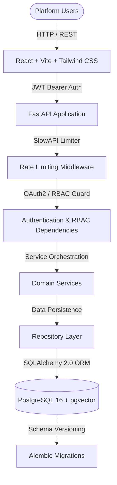

# Smart Campus Intelligence — Platform Architecture (Module 0)

## 1. System Overview

**Smart Campus Intelligence** is an enterprise-grade AI-powered student success and institutional intelligence platform. Module 0 establishes the clean monorepo foundation, persistent database architecture, role-based access control (RBAC), and modern frontend interface.



## 2. Monorepo Organization

```
RIO Prototype v0.1/
├── backend/                  # FastAPI Application
│   ├── alembic/              # Alembic database migrations
│   ├── app/
│   │   ├── api/              # API endpoints (v1 routes & auth dependencies)
│   │   ├── core/             # Configuration, Database engine, Security utilities
│   │   ├── models/           # SQLAlchemy ORM entity models
│   │   ├── repositories/     # Data abstraction layer
│   │   ├── schemas/          # Pydantic validation schemas
│   │   ├── services/         # Core business logic & analytics calculations
│   │   └── main.py           # FastAPI entrypoint, middleware, error handlers
│   ├── tests/                # Automated pytest suite (Auth, RBAC, Dashboards)
│   ├── requirements.txt      # Python dependencies
│   └── alembic.ini           # Alembic migration configuration
├── frontend/                 # React 18 + Vite + TypeScript + Tailwind CSS
│   ├── src/
│   │   ├── api/              # Strongly-typed API client
│   │   ├── components/       # Layouts, Dashboards, Modals, State alerts
│   │   ├── contexts/         # AuthContext (RBAC) & ThemeContext (Dark/Light)
│   │   ├── types/            # TypeScript interfaces
│   │   └── main.tsx          # Application entrypoint
│   ├── package.json          # Node dependencies
│   └── tailwind.config.js    # Tailwind configuration with dark mode support
├── database/                 # Seeding scripts & DB initialization
│   ├── seeds/                # Seed script with 5 demo roles & realistic cohorts
│   └── init.sql              # PostgreSQL pgvector extension setup
├── datasets/                 # Institutional seed datasets (CSV & JSON)
├── docker/                   # Dockerfiles for containerized environments
│   ├── Dockerfile.backend
│   └── Dockerfile.frontend
├── documentation/            # Architectural blueprints, ER diagrams & API specs
└── docker-compose.yml        # Docker composition for PostgreSQL, Backend & Frontend
```

## 3. Technology Rationale

| Layer | Technology | Decision Factors |
| :--- | :--- | :--- |
| **Frontend** | React 18, TypeScript, Vite | Fast HMR, strong typing, modular component architecture |
| **Styling** | Tailwind CSS | Utility-first, seamless light/dark mode, enterprise SaaS theme |
| **Charts** | Recharts | Composable SVG-based visualizations |
| **Backend** | Python 3.12+, FastAPI | High performance asynchronous API, native Pydantic v2 schemas |
| **Database** | PostgreSQL 16 + pgvector | Relational integrity with vector embedding readiness for Modules 1-6 |
| **ORM & Migrations**| SQLAlchemy 2.0 + Alembic | Enterprise query generation, strict type safety, reversible migrations |
| **Security** | JWT + Native Bcrypt | Stateless authentication, salted password protection, zero legacy vulnerabilities |
