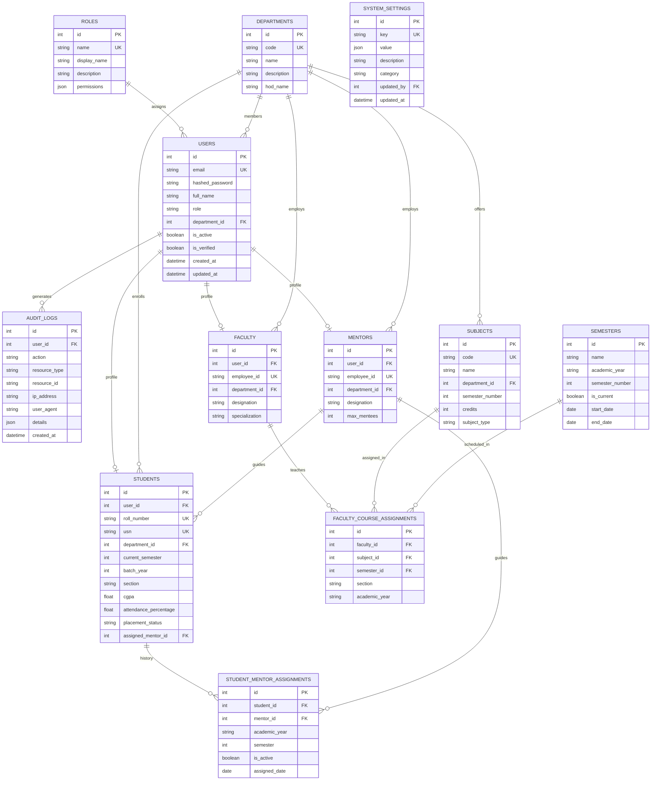

# Entity-Relationship Model (Module 0 Database Schema)

The core relational database model powers user authentication, role hierarchies, departmental structures, academic curricula, faculty allocations, and security audit logs.

