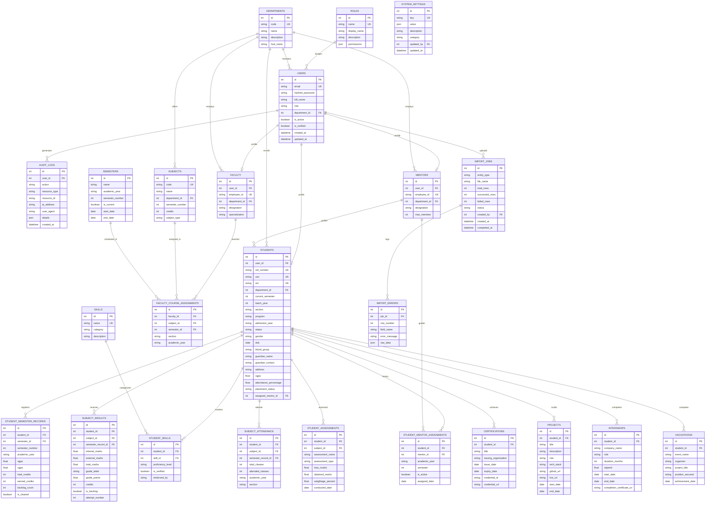

# Entity-Relationship Model (Module 0 & Module 1 Database Schema)

The core relational database model powers user authentication, role hierarchies, departmental structures, academic curricula, student 360-degree intelligence dossiers, dynamic attendance counts, continuous assessments, skills taxonomies, portfolio records, and batch ETL import logs.

