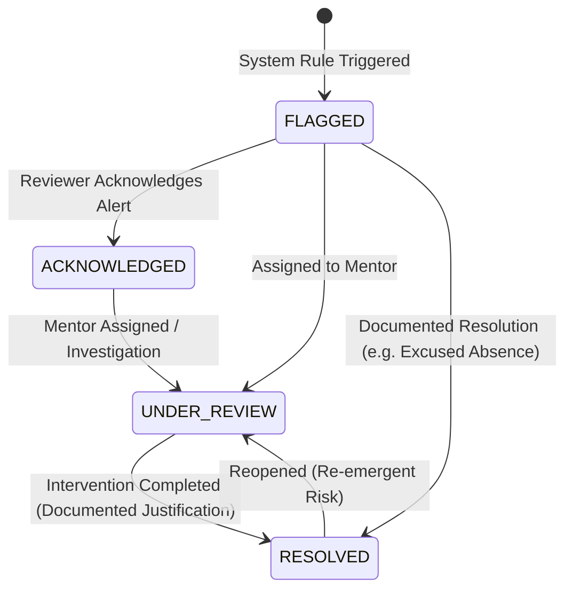

# MODULE 2 — AI-ASSISTED RISK IDENTIFICATION & EARLY WARNING SYSTEM

## 1. Executive & Technical Overview

Module 2 introduces a **configurable, transparent, rule-based student early-warning system** into **Smart Campus Intelligence (RIO Prototype v0.1)**. Building directly upon the academic, attendance, and assessment foundation of Module 1, Module 2 identifies students who may benefit from timely academic support and formative interventions before semester eligibility or progression thresholds are compromised.

> [!IMPORTANT]
> **Core Architectural Principles**:
> 1. **Rule-Based Transparency (Not a Black-Box ML Predictor)**: Every alert corresponds directly to verified, quantifiable indicators (attendance counts, continuous assessment scores, semester SGPA trends, or backlog counts).
> 2. **Never Hardcoded Policies**: All thresholds, operators, severities, and support actions are administrator-configurable via relational rules.
> 3. **Non-Punitive Supportive Purpose**: Alert flags are never used to label a student as a "dropout" or "failure", nor to automate punitive disciplinary actions. They serve purely as early indicators for supportive mentoring.
> 4. **Fact-Grounded Natural Language Explanations**: The AI explanation engine synthesizes verified observed metric evidence into clear, empathetic prose without hallucinating or altering underlying metrics.
> 5. **Duplicate Active Alert Prevention**: Repeated evaluations update metrics on active alerts rather than generating duplicate alert records.

---

## 2. Configurable Early-Warning Policy Rules

The system initializes with 9 canonical rules covering attendance, continuous assessments, academic trends, backlogs, and composite indicators:

| Rule Code | Rule Name | Category | Indicator Type | Operator | Default Threshold | Severity | Suggested Intervention |
| :--- | :--- | :--- | :--- | :---: | :---: | :---: | :--- |
| `RULE_ATT_CRITICAL` | Critical Attendance Shortfall | Attendance | `attendance_percentage` | `<` | `65.0%` | **CRITICAL** | Immediate academic counseling and parental notification. |
| `RULE_ATT_WARNING` | Attendance Early Warning | Attendance | `attendance_percentage` | `<` | `75.0%` | **HIGH** | Faculty advisor 1-on-1 review and attendance warning notice. |
| `RULE_CIA_DEFICIT` | CIA Assessment Deficit | Assessment | `assessment_percentage` | `<` | `40.0%` | **HIGH** | Remedial tutorial assignments and subject faculty consultation. |
| `RULE_CIA_MARGINAL`| Marginal Assessment Performance| Assessment | `assessment_percentage` | `<` | `50.0%` | **MODERATE**| Encourage peer study groups and supplementary coursework. |
| `RULE_SGPA_DROP` | Consecutive SGPA Decline | Academic | `sgpa_drop` | `>=` | `1.00 pt` | **HIGH** | Comprehensive academic progress review with department mentor. |
| `RULE_BACKLOGS_MULT`| Multiple Active Backlogs | Backlog | `backlog_count` | `>=` | `2 courses` | **CRITICAL** | Mandatory exam prep coaching and credit load balancing. |
| `RULE_BACKLOGS_SGL` | Single Active Backlog | Backlog | `backlog_count` | `>=` | `1 course` | **MODERATE**| Re-examination schedule planning with faculty advisor. |
| `RULE_MISSING_ASSESS`| Missing Continuous Evaluations | Assessment | `missing_assessments` | `>=` | `1 missing` | **MODERATE**| Coordinate makeup assessment window with course instructor. |
| `RULE_COMPOUND_RISK`| Combined Attendance & Assessment | Composite | `composite` | `==` | `1.0` | **CRITICAL** | Multi-disciplinary intervention with mentor, course instructor, and HOD. |

*Administrators can adjust thresholds (e.g. increase attendance threshold to 80%), modify severities, deactivate rules, or create new custom rules at runtime through the Rule Configuration Modal.*

---

## 3. Evaluation Triggers & Engine Architecture

Risk assessment is executed through three decoupled operational triggers:
1. **On Student Record Update**: When an administrator or faculty member modifies student attendance, marks, or profile information, `StudentIntelligenceService.update_student()` triggers an automatic scoped re-evaluation for that specific student.
2. **On Demand / Reassessment**: Administrators and faculty can trigger a population-wide or departmental reassessment via `POST /api/v1/risk/evaluate`.
3. **Scheduled Batch Evaluation**: Designed for periodic automated cron execution (e.g., nightly or post-exam upload).

### Duplicate Active Alert Prevention
Active alerts are keyed in memory and the database by `(student_id, rule_id)` for alerts in states `['FLAGGED', 'ACKNOWLEDGED', 'UNDER_REVIEW']`. If a student continues to satisfy the rule condition, the engine updates the existing active alert's observed metric and timestamp rather than spamming duplicate records. If an alert has been `RESOLVED` and the student triggers again in a subsequent academic period, a new alert is generated with a fresh lifecycle.

---

## 4. Alert Lifecycle & Audit Trail

Every lifecycle event records an immutable row in `risk_alert_history` storing:
- Action (`FLAGGED`, `ACKNOWLEDGED`, `NOTE_ADDED`, `ASSIGNED`, `STATUS_CHANGED`, `RESOLVED`, `REOPENED`)
- `performed_by_id` & User Full Name
- `old_status` and `new_status`
- Documented review notes and resolution reasons

---

## 5. In-App Notifications Integration

When early warnings with `CRITICAL` or `HIGH` severities are triggered or escalated:
1. An `InAppNotification` is dispatched to the student's **Assigned Mentor**.
2. Notifications are dispatched to **Department Faculty and HODs**.
3. Real-time bell dropdown in `TopNavbar` highlights unread alerts with direct 1-click mark-as-read functionality.

---

## 6. REST API Endpoints

| Method | Endpoint | Allowed Roles | Description |
| :--- | :--- | :--- | :--- |
| `GET` | `/api/v1/risk/rules` | All Authenticated | Retrieve all policy rules. |
| `POST` | `/api/v1/risk/rules` | Administrator | Register new custom early-warning rule. |
| `PUT` | `/api/v1/risk/rules/{id}` | Administrator | Update rule thresholds, severity, or active state. |
| `DELETE`| `/api/v1/risk/rules/{id}` | Administrator | Delete custom policy rule. |
| `POST` | `/api/v1/risk/evaluate` | Admin, Faculty, Mentor | Execute rule detection across students. |
| `GET` | `/api/v1/risk/alerts` | All (Role Scoped) | Query filterable risk alerts (Students see only self). |
| `GET` | `/api/v1/risk/alerts/{id}` | All (Role Scoped) | Full alert dossier with evidence, AI explanation, and audit trail. |
| `POST` | `/api/v1/risk/alerts/{id}/acknowledge` | Admin, Faculty, Mentor | Mark alert as acknowledged. |
| `POST` | `/api/v1/risk/alerts/{id}/notes` | Admin, Faculty, Mentor | Add documented review note to alert audit log. |
| `POST` | `/api/v1/risk/alerts/{id}/assign`| Admin, Faculty, Mentor | Assign alert to academic mentor. |
| `POST` | `/api/v1/risk/alerts/{id}/resolve`| Admin, Faculty, Mentor | Mark alert resolved with justification reason. |
| `POST` | `/api/v1/risk/alerts/{id}/reopen` | Admin, Faculty, Mentor | Reopen previously resolved alert. |
| `GET` | `/api/v1/risk/students/{id}` | All (Role Scoped) | Comprehensive student early-warning summary. |
| `GET` | `/api/v1/risk/statistics` | Admin, Faculty, Mentor, Placement | Aggregate metrics and distribution charts. |
| `GET` | `/api/v1/risk/notifications` | Current User | In-app alert notification center. |
| `PUT` | `/api/v1/risk/notifications/{id}/read` | Current User | Mark notification as read. |

---

## 7. Testing & Verification Matrix

The test suite in [`backend/tests/test_risk_intelligence.py`](file:///Users/sanith/Documents/RIO/RIO Prototype v0.1/backend/tests/test_risk_intelligence.py) verifies:

| Test Case | Verified Behavior | Status |
| :--- | :--- | :---: |
| `test_rules_retrieval_and_admin_crud` | Canonical rules load; student blocked from rule creation (`403`); Admin creates, updates, and deletes rules. | **PASSED** |
| `test_attendance_boundary_conditions` | Student at 74.0% triggers `< 75.0%` alert; Student at exactly 75.0% does NOT trigger. | **PASSED** |
| `test_declining_performance_trigger` | Student with SGPA drop from 8.4 to 7.1 (Δ 1.3 >= 1.0) triggers `RULE_SGPA_DROP` with exact diff explanation. | **PASSED** |
| `test_healthy_no_trigger_student` | High-performing student with 95% attendance and 9.2 CGPA generates zero risk alerts. | **PASSED** |
| `test_duplicate_alert_prevention` | Consecutive evaluation runs against low-attendance student update in-place without duplicate alert records. | **PASSED** |
| `test_alert_lifecycle_workflow` | Faculty acknowledges alert, appends review note, resolves with justification; audit trail verified; Student forbidden from resolving (`403`). | **PASSED** |
| `test_student_risk_isolation` | Student can query personal risk profile; Student querying another student receives `403 Forbidden`. | **PASSED** |

**Total Suite Result**: All 20 tests passed (`6` Module 0 + `7` Module 1 + `7` Module 2) in 4.48s.

---

## 8. Preserved UI Screenshots

| Screenshot | Description |
| :--- | :--- |
| `12_risk_early_warning_dashboard.png` | Executive early-warning center with KPI cards, severity distribution donut, department bar chart, and filterable alerts roster. |
| `13_risk_alert_detail_modal.png` | Comprehensive alert inspection drawer featuring quantitative evidence, fact-grounded AI explanation, recommended action, and mentor assignment controls. |
| `14_risk_policy_rule_configuration.png`| Administrator rule configuration modal with dynamic threshold tuning, operator selection, severity adjustments, and activation toggles. |
| `15_student_dossier_early_warning_tab.png`| 360° student profile modal featuring the dedicated "Early-Warning Alerts" tab and intervention history. |
