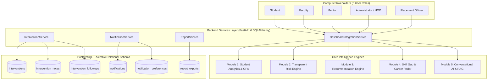
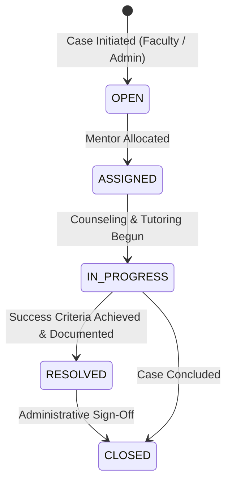

# Module 6 — Role-Based Dashboards & Intervention Tracking

## Executive Overview
**Module 6** marks the complete integration capstone of the **Smart Campus Intelligence Platform**. It unites all previously implemented modules (Module 0 Foundation, Module 1 Student Intelligence & Analytics, Module 2 AI Risk Detection, Module 3 Personalized Recommendations, Module 4 Placement Readiness, and Module 5 Conversational AI & RAG) into unified role-specific dashboards and delivers an institutional-grade **Student Intervention & Mentorship Management System**.

---

## 1. Architectural Architecture & Role-Based Scoping

---

## 2. Five Unified Role Dashboards

### 1. Student Integrated Dashboard
- **Academic Progression & SGPA Curves**: Visual progression chart tracking semester SGPA alongside cumulative CGPA on a verified 10.0 scale.
- **Attendance & Thresholds**: Real-time biometric attendance metrics evaluated against university condonation boundaries (75% minimum).
- **Placement Readiness Radar**: Placement readiness score calculated from CGPA, attendance, and verified skills.
- **Transparent Early-Warning Signals**: Explanations of risk triggers with clear non-punitive rationale.
- **Targeted Recommendations**: High-relevance learning pathways, algorithmic modules, and external learning resources.
- **Curriculum Subject Details**: Active enrolled subjects with credits, course codes, and section breakdown.
- **Assigned Mentor**: Direct link to allocated faculty mentor.

### 2. Faculty Cohort Dashboard
- **Cohort Grade Distribution**: Categorization across Distinction ($\ge 8.5$), First Class ($7.0 - 8.4$), Second Class ($6.0 - 6.9$), and Needs Support ($< 6.0$).
- **Allocated Teaching Courses**: Active syllabus assignments, course codes, sections, and credit hours.
- **Department Early-Warning Radar**: Cohort-level attendance and academic risk alerts flagged for review.
- **Referral to Mentorship**: Capability to refer students needing remedial academic counseling.

### 3. Mentor Central Dashboard
- **Assigned Mentee Roster**: Cohort surveillance table with USN, branch, semester, CGPA, attendance, and real-time standing.
- **Active Support Interventions**: Live case tracker indicating priorities, statuses, and student names.
- **Scheduled Follow-Up Sessions**: Direct visibility into upcoming review checkpoints and counseling follow-ups.
- **Mentee Risk Radar**: Instant alerts when an assigned mentee breaches attendance or continuous assessment thresholds.

### 4. Administrator / HOD Executive Dashboard
- **Institutional Department Breakdown**: Comparative table of students, faculty, average CGPA, and attendance across all departments.
- **College-wide Early-Warning Severity Distribution**: Breakdown of Critical, High, Moderate, and Normal priority flags.
- **Intervention Lifecycle Statistics**: Metrics on Open, In Progress, and Resolved student support cases.
- **System & Engine Status**: Real-time operational verification for RAG vector search and LLM pipeline.

### 5. Placement Officer Dashboard
- **Corporate Recruitment Pipeline Funnel**: Visual tracking of candidate progress from Application Submitted $\rightarrow$ Candidate Shortlisted $\rightarrow$ Interview Rounds $\rightarrow$ Offers Extended $\rightarrow$ Placed.
- **Benchmark Alignment**: Career role requirements (Software Developer, Data Analyst, Cloud Engineer, AI/ML Specialist).
- **Eligible Candidates Roster**: Real-time filtering based on minimum CGPA, attendance thresholds, and verified skills.
- **Active Corporate Drives**: Live listing of recruitment partner openings with deadlines and compensation packages.

---

## 3. Intervention Lifecycle & State Machine

### Intervention Features
- **Categorization**: `ACADEMIC_REMEDIAL`, `ATTENDANCE_CONDONATION_COUNSELING`, `CAREER_SKILL_COACHING`, `EXAM_PREPARATION_SUPPORT`, `PARENT_TEACHER_CONFERENCE`, `WELLNESS_COUNSELING`.
- **Timestamped Audit Notes**: Logged by mentors or faculty (`COUNSELING`, `OBSERVATION`, `ACTION_ITEM`, `PARENT_COMMUNICATION`).
- **Structured Follow-ups**: Scheduled review sessions with recorded outcomes, student feedback, and next review dates.
- **Formal Resolution Dossier**: Required resolution summary upon case completion.

---

## 4. Multi-Channel In-App Notifications

- **Event-Driven Triggers**:
  - `RISK_ALERT`: Dispatched when risk evaluation breaches threshold.
  - `MENTOR_ASSIGNMENT`: Dispatched to student and mentor on case allocation.
  - `NEW_RECOMMENDATION`: Dispatched when career roadmap matches new skill courses.
  - `INTERVENTION_FOLLOWUP`: Dispatched to remind participants of scheduled sessions.
  - `STATUS_UPDATE`: Dispatched on milestone status changes.
  - `ADMINISTRATIVE_ANNOUNCEMENT`: Broadcasted institutional alerts.
- **User Preference Management**: Configurable toggles per category and email alert preferences.
- **Unread Badge & Real-Time Sync**: Real-time unread badge counter in top navigation bar with one-click "Mark All Read".

---

## 5. Institutional Compliance & Governance Reports

- **Supported Formats**: CSV (Excel compatible), JSON.
- **Canonical Report Types**:
  1. `STUDENT_PROGRESS`: Full academic standing, USN, SRN, SGPA, CGPA, attendance, backlogs, readiness.
  2. `MENTOR_INTERVENTIONS`: Support audit, scheduled reviews, and closure summaries.
  3. `DEPARTMENT_SUMMARY`: Departmental comparisons, faculty ratios, average CGPA and attendance.
  4. `RISK_SUMMARY`: Early-warning policy triggers, detected values vs thresholds.
  5. `PLACEMENT_READINESS`: Corporate recruitment eligibility and student application stats.

---

## 6. Verification & Automated Test Suite

- Total Monorepo Test Coverage: **53 passing tests / 53 total**.
- Module 6 Test Suite: `backend/tests/test_interventions_and_dashboards.py` (9 tests passing).
- Clean frontend production build via TypeScript and Vite.
