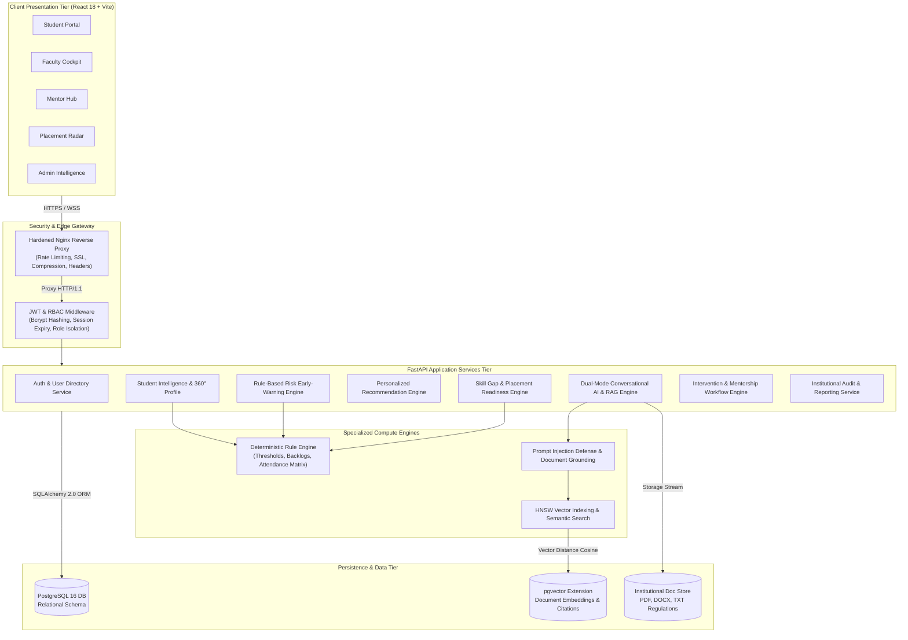

# Smart Campus Intelligence — System Architecture Specification

## 1. Executive Overview

**Smart Campus Intelligence** is an enterprise-grade institutional intelligence and student success ecosystem engineered for universities and higher education institutions. The platform consolidates student academic progression, continuous internal assessments, dynamic attendance telemetry, self-reported and verified competencies, early-warning risk identification, automated recommendation synthesis, and conversational AI into a unified, role-governed monorepo.

The platform provides dedicated, security-enforced interfaces for five core institutional personas:
1. **Students**: Real-time academic tracking, attendance alerts, career readiness benchmarking, and personal AI tutoring.
2. **Faculty**: Cohort analytics, continuous assessment gradebook evaluation, risk radar monitoring, and skill evidence verification.
3. **Mentors**: Assigned mentee caseload management, early-warning intervention tracking, and structured support timelines.
4. **Placement Officers**: Institutional readiness scoring, industry skill demand tracking, and recruitment drive matching.
5. **Administrators & HODs**: Executive campus intelligence, batch data ingestion pipelines, policy rule configurations, and regulatory compliance audit logging.

---

## 2. Monorepo Structural Architecture

```
RIO Prototype v0.1/
├── backend/                  # FastAPI 0.110+ Core Application
│   ├── alembic/              # Database schema migration versions
│   ├── app/
│   │   ├── api/              # RESTful API route controllers (v1)
│   │   ├── core/             # Configuration, database engine, security tokens
│   │   ├── models/           # SQLAlchemy 2.0 ORM domain entities
│   │   ├── schemas/          # Pydantic v2 validation and serialization schemas
│   │   └── services/         # Domain intelligence business logic & algorithms
│   └── tests/                # Pytest integration, security, and benchmark suites
├── frontend/                 # React 18 + TypeScript + Vite SPA
│   ├── src/
│   │   ├── api/              # Strongly typed API client & HTTP interceptors
│   │   ├── components/       # Reusable UI component library (Tailwind CSS)
│   │   │   ├── auth/         # Login & password recovery interfaces
│   │   │   ├── dashboard/    # Dynamic role-based dashboard views
│   │   │   ├── chat/         # Dual-mode AI assistant & RAG manager
│   │   │   ├── interventions/# Mentor caseload, timeline & follow-up hub
│   │   │   ├── placement/    # Skill gap radar & opportunity explorer
│   │   │   ├── recommendations/# Adaptive student guidance roadmap
│   │   │   ├── risk/         # Early-warning radar & policy config
│   │   │   ├── students/     # Student 360° dossiers & records
│   │   │   └── reports/      # Institutional analytics export center
│   │   └── contexts/         # Authentication, Theme, & Global UI State
│   └── test_frontend_workflows.js # Headless Chrome E2E Puppeteer test suite
├── database/                 # Database migrations, SQL seeds, backup scripts
├── docker/                   # Dockerfiles (dev/prod) & hardened Nginx config
├── documentation/            # Technical specifications, user guides, QA reports
└── datasets/                 # Canonical academic syllabi, regulations, student CSVs
```

---

## 3. High-Level Component Architecture Diagram



---

## 4. Key Architectural Patterns & Security Principles

### 4.1 Strict Cross-Student Data Isolation
Every student data request is verified against the authenticated user context. Students may only access records associated with their own `student_id`. Attempts to access other student IDs result in immediate `403 Forbidden` exceptions with security audit logging.

### 4.2 Transparent, Configurable Rule Engines
University policies regarding attendance minimums, continuous evaluation criteria, and backlog barriers are never hardcoded. Administrators configure policy thresholds via dedicated API endpoints (`/api/v1/risk/rules`). Every alert generated includes transparent mathematical explanations showing observed metric values vs configured thresholds.

### 4.3 Dual-Mode Conversational AI Architecture
The platform integrates an AI assistant operating in two strictly isolated modes within a unified interface:
- **Mode A (Public Campus Assistant)**: Accessible unauthenticated. Answers general university questions and explains official policies grounded via RAG embeddings. Has zero access to private student records and automatically refuses confidential data inquiries.
- **Mode B (Authenticated Student Assistant)**: Accessible only with a valid student JWT. Dynamically injects authorized student context (current SGPA, backlog count, subject attendance, active risk alerts, target career readiness) to generate tailored study schedules and academic guidance.

### 4.4 Defense-in-Depth Prompt Injection Shield
All conversational queries undergo prompt injection scanning against adversarial jailbreak signatures (`ignore prior instructions`, `jailbroken`, `system override`). In addition, untrusted context extracted from uploaded documents is sanitized before reaching the generation pipeline.
