> **Archived — prototype v0.1 (historical).** This document describes the retired single-institution prototype and is not current ACEDRA documentation. Current documentation is one folder up, in `documentation/`.

# Smart Campus Intelligence — Database Entity-Relationship Diagram

## 1. Relational Entity-Relationship Diagram

```mermaid
erDiagram
    USERS ||--o{ STUDENTS : "profile for"
    USERS ||--o{ AUDIT_LOGS : "performed by"
    DEPARTMENTS ||--o{ USERS : "belongs to"
    DEPARTMENTS ||--o{ STUDENTS : "enrolled in"
    DEPARTMENTS ||--o{ SUBJECTS : "offers"
    DEPARTMENTS ||--o{ CAREER_ROLES : "aligned with"

    STUDENTS ||--o{ SEMESTER_RECORDS : "progresses through"
    SEMESTER_RECORDS ||--o{ SUBJECT_RESULTS : "contains grades for"
    STUDENTS ||--o{ ATTENDANCE_RECORDS : "logs attendance for"
    STUDENTS ||--o{ STUDENT_SKILLS : "possesses"
    STUDENTS ||--o{ RISK_ALERTS : "triggered for"
    STUDENTS ||--o{ RECOMMENDATIONS : "prescribed to"
    STUDENTS ||--o{ INTERVENTIONS : "receives support via"
    STUDENTS ||--o{ STUDENT_APPLICATIONS : "submits for"

    SUBJECTS ||--o{ SUBJECT_RESULTS : "scored under"
    SUBJECTS ||--o{ ATTENDANCE_RECORDS : "attendance tracked in"
    SUBJECTS ||--o{ ASSESSMENTS : "evaluated by"

    RISK_RULES ||--o{ RISK_ALERTS : "triggers"
    USERS ||--o{ RISK_ALERTS : "assigned mentor"
    
    RECOMMENDATION_CATALOGUE ||--o{ RECOMMENDATIONS : "templated from"
    
    SKILLS ||--o{ STUDENT_SKILLS : "categorizes"
    SKILLS ||--o{ ROLE_SKILLS : "required by"
    CAREER_ROLES ||--o{ ROLE_SKILLS : "specifies"

    STUDENT_SKILLS ||--o{ SKILL_EVIDENCES : "validated by"
    USERS ||--o{ SKILL_EVIDENCES : "verified by"

    PLACEMENT_OPPORTUNITIES ||--o{ OPPORTUNITY_REQUIREMENTS : "mandates"
    PLACEMENT_OPPORTUNITIES ||--o{ STUDENT_APPLICATIONS : "receives"
    SKILLS ||--o{ OPPORTUNITY_REQUIREMENTS : "referenced in"

    USERS ||--o{ CONVERSATIONS : "initiates"
    CONVERSATIONS ||--o{ MESSAGES : "contains"
    DOCUMENTS ||--o{ DOCUMENT_CHUNKS : "partitioned into"

    INTERVENTIONS ||--o{ INTERVENTION_NOTES : "logged under"
    INTERVENTIONS ||--o{ INTERVENTION_FOLLOWUPS : "scheduled for"
    USERS ||--o{ INTERVENTIONS : "managed by"

    USERS {
        int id PK
        string email UK
        string hashed_password
        string full_name
        string role "student, faculty, mentor, admin, placement_officer"
        int department_id FK
        boolean is_active
        datetime created_at
    }

    STUDENTS {
        int id PK
        int user_id FK, UK
        string srn UK
        string usn UK
        int department_id FK
        string program
        int current_semester
        string section
        int admission_year
        float cgpa
        float attendance_percentage
        int total_backlogs
        int active_backlogs
        string status "ACTIVE, PROBATION, DETAINED, GRADUATED"
    }

    SEMESTER_RECORDS {
        int id PK
        int student_id FK
        int semester_number
        string academic_year
        float sgpa
        int total_credits
        int earned_credits
        string status
    }

    SUBJECTS {
        int id PK
        string code UK
        string name
        int department_id FK
        int semester
        int credits
        string subject_type "THEORY, LAB, INTEGRATED"
    }

    SUBJECT_RESULTS {
        int id PK
        int semester_record_id FK
        int subject_id FK
        float internal_marks
        float external_marks
        float total_marks
        string grade
        float grade_points
        boolean is_backlog
    }

    ATTENDANCE_RECORDS {
        int id PK
        int student_id FK
        int subject_id FK
        int semester
        int total_classes
        int attended_classes
        float percentage
        string status "HEALTHY, WARNING, CRITICAL"
    }

    RISK_RULES {
        int id PK
        string code UK
        string name
        string category "ATTENDANCE, MARKS, BACKLOGS, TREND, COMBINED"
        string severity "LOW, MODERATE, HIGH, CRITICAL"
        json parameters
        boolean is_active
    }

    RISK_ALERTS {
        int id PK
        int student_id FK
        int rule_id FK
        string severity
        string status "TRIGGERED, ACKNOWLEDGED, UNDER_REVIEW, RESOLVED"
        float observed_value
        string observed_display
        float threshold_value
        string threshold_display
        text ai_explanation
        text suggested_action
        int assigned_mentor_id FK
    }

    RECOMMENDATION_CATALOGUE {
        int id PK
        string title
        string category "SUBJECT_IMPROVEMENT, CERTIFICATION, SKILL, PROJECT, PLACEMENT"
        text description
        string required_skill
        string difficulty_level
        string resource_url
        string estimated_duration
    }

    RECOMMENDATIONS {
        int id PK
        int student_id FK
        int catalogue_item_id FK
        string title
        string category
        float relevance_score
        string status "SUGGESTED, ACCEPTED, IN_PROGRESS, COMPLETED, REJECTED"
        text ai_rationale
    }

    CAREER_ROLES {
        int id PK
        string code UK
        string title
        int department_id FK
        text description
        string average_salary_range
        string industry_demand
        boolean is_active
    }

    SKILLS {
        int id PK
        string name UK
        string category
        text description
    }

    ROLE_SKILLS {
        int id PK
        int role_id FK
        int skill_id FK
        string min_proficiency
        string importance "MANDATORY, PREFERRED, OPTIONAL"
        float importance_weight
        boolean is_mandatory
    }

    STUDENT_SKILLS {
        int id PK
        int student_id FK
        int skill_id FK
        string proficiency_level "Beginner, Intermediate, Advanced, Expert"
        boolean is_verified
        int verification_score
    }

    SKILL_EVIDENCES {
        int id PK
        int student_skill_id FK
        string evidence_type "PROJECT_REPO, CERTIFICATE, DEMO_URL, CODE_SAMPLE"
        string title
        string verification_status "PENDING, VERIFIED, REJECTED"
        int verified_by_id FK
    }

    PLACEMENT_OPPORTUNITIES {
        int id PK
        string company_name
        string job_title
        string opportunity_type "FULL_TIME, INTERNSHIP"
        float min_cgpa
        int max_backlogs
        string status "ACTIVE, CLOSED"
    }

    DOCUMENTS {
        int id PK
        string title
        string category
        string file_path
        string access_level "public, authenticated, faculty_only, admin_only"
        int chunk_count
    }

    DOCUMENT_CHUNKS {
        int id PK
        int document_id FK
        int chunk_index
        text content
        json embedding "Vector float array / pgvector"
        string section_heading
        int page_number
    }

    INTERVENTIONS {
        int id PK
        int student_id FK
        int assigned_to FK
        string intervention_type
        string priority "LOW, MEDIUM, HIGH, CRITICAL"
        string status "DRAFT, ASSIGNED, IN_PROGRESS, RESOLVED, ESCALATED"
        text reason
        text action_plan
        datetime scheduled_date
        datetime completed_at
    }
```

---

## 2. Relational Schema Integrity & Indexing Strategy

1. **Foreign Key Cascade Policies**:
   - Deletion of a core `Student` record cascades to `SemesterRecord`, `AttendanceRecord`, `StudentSkill`, and `RiskAlert` to prevent orphan entities.
   - Deletion of a `Document` cascades to `DocumentChunk` and associated vector indexes.
2. **Performance Indexes**:
   - `students (user_id)`, `students (srn)`, `students (department_id, current_semester)`
   - `attendance_records (student_id, subject_id, semester)`
   - `risk_alerts (student_id, status)`, `risk_alerts (severity, detected_date)`
   - `recommendations (student_id, status)`
   - `student_skills (student_id, skill_id)`
   - `document_chunks (document_id, chunk_index)`
3. **Unique Constraints**:
   - `users.email` (Unique index)
   - `students.srn`, `students.usn` (Unique indexes)
   - `skills.name` (Unique index)
   - `career_roles.code` (Unique index)
   - `(student_id, skill_id)` on `student_skills` to prevent duplicate skill records.
