> **Archived — prototype v0.1 (historical).** This document describes the retired single-institution prototype and is not current ACEDRA documentation. Current documentation is one folder up, in `documentation/`.

# Entity-Relationship Model (Module 0, 1, 2, 3, 4 & 5 Database Schema)

The core relational database model powers user authentication, role hierarchies, departmental structures, academic curricula, student 360-degree intelligence dossiers, dynamic attendance counts, continuous assessments, skills taxonomies, portfolio records, batch ETL import logs, configurable risk policy rules, early-warning alerts, alert assignment workflows, audit histories, in-app notifications, approved resource catalogues, personalized recommendations, multi-resource links, progress milestone tracking, student feedback ratings, career role benchmarks, competency weights, skill evidence submissions, corporate recruitment opportunities, multi-factor eligibility checks, student application pipelines, RAG knowledge documents, text chunks, vector embeddings, access permission rules, dual-mode conversations, grounded message citations, and user satisfaction feedback.

```mermaid
erDiagram
    USERS ||--o{ AUDIT_LOGS : generates
    USERS ||--o| STUDENTS : profile
    USERS ||--o| FACULTY : profile
    USERS ||--o| MENTORS : profile
    USERS ||--o{ IMPORT_JOBS : uploads
    USERS ||--o{ IN_APP_NOTIFICATIONS : receives
    ROLES ||--o{ USERS : assigns
    DEPARTMENTS ||--o{ USERS : members
    DEPARTMENTS ||--o{ SUBJECTS : offers
    DEPARTMENTS ||--o{ STUDENTS : enrolls
    DEPARTMENTS ||--o{ FACULTY : employs
    DEPARTMENTS ||--o{ MENTORS : employs
    FACULTY ||--o{ FACULTY_COURSE_ASSIGNMENTS : teaches
    SUBJECTS ||--o{ FACULTY_COURSE_ASSIGNMENTS : assigned_in
    SEMESTERS ||--o{ FACULTY_COURSE_ASSIGNMENTS : scheduled_in
    MENTORS ||--o{ STUDENTS : guides
    STUDENTS ||--o{ STUDENT_MENTOR_ASSIGNMENTS : history
    MENTORS ||--o{ STUDENT_MENTOR_ASSIGNMENTS : guides

    STUDENTS ||--o{ STUDENT_SEMESTER_RECORDS : registers
    STUDENTS ||--o{ SUBJECT_RESULTS : receives
    STUDENTS ||--o{ SUBJECT_ATTENDANCE : attends
    STUDENTS ||--o{ STUDENT_ASSESSMENTS : assessed
    STUDENTS ||--o{ STUDENT_SKILLS : masters
    SKILLS ||--o{ STUDENT_SKILLS : categorized
    STUDENTS ||--o{ CERTIFICATIONS : achieves
    STUDENTS ||--o{ PROJECTS : builds
    STUDENTS ||--o{ INTERNSHIPS : completes
    STUDENTS ||--o{ HACKATHONS : competes
    IMPORT_JOBS ||--o{ IMPORT_ERRORS : logs

    STUDENTS ||--o{ RISK_ALERTS : flagged
    RISK_RULES ||--o{ RISK_ALERTS : defines
    RISK_EVALUATIONS ||--o{ RISK_ALERTS : generated_in
    RISK_ALERTS ||--o{ RISK_ALERT_HISTORY : audited
    RISK_ALERTS ||--o{ ALERT_ASSIGNMENTS : assigned
    MENTORS ||--o{ ALERT_ASSIGNMENTS : assigned_to

    STUDENTS ||--o{ RECOMMENDATIONS : receives
    RECOMMENDATION_CATALOGUE ||--o{ RECOMMENDATIONS : catalogue_ref
    RECOMMENDATIONS ||--o{ RECOMMENDATION_RESOURCES : contains
    RECOMMENDATIONS ||--o{ RECOMMENDATION_PROGRESS : tracks
    RECOMMENDATIONS ||--o| RECOMMENDATION_FEEDBACK : rates
    USERS ||--o{ RECOMMENDATIONS : suggested_by_mentor

    STUDENT_SKILLS ||--o{ SKILL_EVIDENCE : verified_by_evidence
    CAREER_ROLES ||--o{ ROLE_SKILLS : defines_requirements
    SKILLS ||--o{ ROLE_SKILLS : benchmarked_in
    CAREER_ROLES ||--o{ PLACEMENT_OPPORTUNITIES : associated_with
    PLACEMENT_OPPORTUNITIES ||--o{ OPPORTUNITY_REQUIREMENTS : specifies
    PLACEMENT_OPPORTUNITIES ||--o{ STUDENT_APPLICATIONS : candidate_applications
    STUDENTS ||--o{ STUDENT_APPLICATIONS : submits_applications

    DOCUMENTS ||--o{ DOCUMENT_CHUNKS : chunks
    DOCUMENTS ||--o{ DOCUMENT_ACCESS_RULES : permissions
    USERS ||--o{ DOCUMENTS : creates
    CONVERSATIONS ||--o{ MESSAGES : contains
    MESSAGES ||--o{ CONVERSATION_FEEDBACK : feedback
    USERS ||--o{ CONVERSATIONS : initiates

    USERS {
        int id PK
        string email UK
        string hashed_password
        string full_name
        string role
        int department_id FK
        boolean is_active
        boolean is_verified
        datetime created_at
        datetime updated_at
    }

    ROLES {
        int id PK
        string name UK
        string display_name
        string description
        json permissions
    }

    DEPARTMENTS {
        int id PK
        string code UK
        string name
        string description
        string hod_name
    }

    STUDENTS {
        int id PK
        int user_id FK
        string roll_number UK
        string usn UK
        string srn UK
        int department_id FK
        int current_semester
        int batch_year
        string section
        string program
        string admission_year
        string status
        string gender
        date dob
        string blood_group
        string guardian_name
        string guardian_contact
        string address
        float cgpa
        float attendance_percentage
        string placement_status
        int assigned_mentor_id FK
    }

    RISK_RULES {
        int id PK
        string name
        string code UK
        string description
        string category
        string severity
        string indicator_type
        string operator
        float threshold_value
        json conditions_config
        string suggested_action
        boolean is_active
        int created_by_id FK
    }

    RISK_ALERTS {
        int id PK
        int student_id FK
        int rule_id FK
        int evaluation_id FK
        string severity
        string status
        float observed_value
        string observed_display
        float threshold_value
        string threshold_display
        string academic_period
        int subject_id FK
        datetime detected_date
        boolean is_system_generated
        text ai_explanation
        string suggested_action
        int assigned_mentor_id FK
        text review_notes
        int resolved_by_id FK
        datetime resolved_at
        string resolution_reason
    }

    RISK_EVALUATIONS {
        int id PK
        string run_type
        int initiated_by_id FK
        int evaluated_students_count
        int alerts_generated_count
        int critical_count
        int high_count
        int moderate_count
        int normal_count
        string status
        json summary
        datetime completed_at
    }

    RISK_ALERT_HISTORY {
        int id PK
        int alert_id FK
        string action
        string old_status
        string new_status
        text notes
        int performed_by_id FK
        datetime created_at
    }

    ALERT_ASSIGNMENTS {
        int id PK
        int alert_id FK
        int mentor_id FK
        int assigned_by_id FK
        datetime assigned_at
        text notes
        string status
    }

    IN_APP_NOTIFICATIONS {
        int id PK
        int user_id FK
        string title
        text message
        string notification_type
        string severity
        int reference_id
        string reference_type
        boolean is_read
        datetime created_at
    }

    STUDENT_SEMESTER_RECORDS {
        int id PK
        int student_id FK
        int semester_id FK
        int semester_number
        string academic_year
        float sgpa
        float cgpa
        int total_credits
        int earned_credits
        int backlog_count
        boolean is_cleared
    }

    SUBJECT_RESULTS {
        int id PK
        int student_id FK
        int subject_id FK
        int semester_record_id FK
        float internal_marks
        float external_marks
        float total_marks
        string grade_letter
        float grade_points
        int credits
        boolean is_backlog
        int attempt_number
    }

    SUBJECT_ATTENDANCE {
        int id PK
        int student_id FK
        int subject_id FK
        int semester_record_id FK
        int total_classes
        int attended_classes
        string academic_year
        string section
    }

    STUDENT_ASSESSMENTS {
        int id PK
        int student_id FK
        int subject_id FK
        string assessment_name
        string assessment_type
        float max_marks
        float obtained_marks
        float weightage_percent
        date conducted_date
    }

    SKILLS {
        int id PK
        string name UK
        string category
        string description
    }

    STUDENT_SKILLS {
        int id PK
        int student_id FK
        int skill_id FK
        string proficiency_level
        boolean is_verified
        string endorsed_by
    }

    CERTIFICATIONS {
        int id PK
        int student_id FK
        string title
        string issuing_organization
        date issue_date
        date expiry_date
        string credential_id
        string credential_url
    }

    PROJECTS {
        int id PK
        int student_id FK
        string title
        string description
        string role
        string tech_stack
        string github_url
        string live_url
        date start_date
        date end_date
    }

    INTERNSHIPS {
        int id PK
        int student_id FK
        string company_name
        string role
        int duration_months
        float stipend
        date start_date
        date end_date
        string completion_certificate_url
    }

    HACKATHONS {
        int id PK
        int student_id FK
        string event_name
        string organizer
        string project_title
        string position_secured
        date achievement_date
    }

    IMPORT_JOBS {
        int id PK
        string entity_type
        string file_name
        int total_rows
        int successful_rows
        int failed_rows
        string status
        int created_by FK
        datetime created_at
        datetime completed_at
    }

    IMPORT_ERRORS {
        int id PK
        int job_id FK
        int row_number
        string field_name
        string error_message
        json raw_data
    }

    FACULTY {
        int id PK
        int user_id FK
        string employee_id UK
        int department_id FK
        string designation
        string specialization
    }

    MENTORS {
        int id PK
        int user_id FK
        string employee_id UK
        int department_id FK
        string designation
        int max_mentees
    }

    SEMESTERS {
        int id PK
        string name
        string academic_year
        int semester_number
        boolean is_current
        date start_date
        date end_date
    }

    SUBJECTS {
        int id PK
        string code UK
        string name
        int department_id FK
        int semester_number
        int credits
        string subject_type
    }

    FACULTY_COURSE_ASSIGNMENTS {
        int id PK
        int faculty_id FK
        int subject_id FK
        int semester_id FK
        string section
        string academic_year
    }

    STUDENT_MENTOR_ASSIGNMENTS {
        int id PK
        int student_id FK
        int mentor_id FK
        string academic_year
        int semester
        boolean is_active
        date assigned_date
    }

    AUDIT_LOGS {
        int id PK
        int user_id FK
        string action
        string resource_type
        string resource_id
        string ip_address
        string user_agent
        json details
        datetime created_at
    }

    SYSTEM_SETTINGS {
        int id PK
        string key UK
        json value
        string description
        string category
        int updated_by FK
        datetime updated_at
    }

    RECOMMENDATION_CATALOGUE {
        int id PK
        string title
        string category
        text description
        string required_skill
        string target_audience
        string difficulty_level
        string resource_url
        string estimated_duration
        json eligibility_conditions
        boolean is_active
        datetime created_at
        datetime updated_at
    }

    RECOMMENDATIONS {
        int id PK
        int student_id FK
        int catalogue_id FK
        string category
        string title
        text reason
        string related_gap
        text expected_outcome
        string priority
        string status
        string source
        int suggested_by FK
        text mentor_guidance
        string resource_url
        string suggested_completion_time
        datetime accepted_at
        datetime completed_at
        datetime created_at
        datetime updated_at
    }

    RECOMMENDATION_RESOURCES {
        int id PK
        int recommendation_id FK
        string title
        string resource_type
        string url
        string description
        int sequence_order
    }

    RECOMMENDATION_PROGRESS {
        int id PK
        int recommendation_id FK
        int percent_complete
        string status_update
        text notes
        float hours_spent
        datetime logged_at
    }

    RECOMMENDATION_FEEDBACK {
        int id PK
        int recommendation_id FK
        int rating
        boolean helpful
        int relevance_score
        text comments
        boolean outcome_achieved
        datetime submitted_at
    }

    SKILL_EVIDENCE {
        int id PK
        int student_skill_id FK
        int student_id FK
        string evidence_type
        string title
        string url
        string verification_status
        int verified_by FK
        datetime verified_at
        text verification_notes
        datetime submitted_at
    }

    CAREER_ROLES {
        int id PK
        string code UK
        string title
        text description
        string industry_sector
        float target_readiness_threshold
        boolean is_active
        datetime created_at
        datetime updated_at
    }

    ROLE_SKILLS {
        int id PK
        int role_id FK
        int skill_id FK
        string required_proficiency
        string importance
        float weight
        boolean is_mandatory
    }

    PLACEMENT_OPPORTUNITIES {
        int id PK
        int career_role_id FK
        string company_name
        string role_title
        string job_type
        string location
        string ctc_range
        float min_cgpa
        int max_backlogs_allowed
        float min_attendance_pct
        json eligible_departments
        json eligible_semesters
        datetime application_deadline
        string status
        datetime created_at
        datetime updated_at
    }

    OPPORTUNITY_REQUIREMENTS {
        int id PK
        int opportunity_id FK
        int skill_id FK
        string min_proficiency
        boolean is_mandatory
    }

    STUDENT_APPLICATIONS {
        int id PK
        int opportunity_id FK
        int student_id FK
        string application_status
        float readiness_score_at_apply
        string resume_url
        text cover_statement
        text feedback_notes
        datetime applied_at
        datetime updated_at
    }

    DOCUMENTS {
        int id PK
        string title
        string category
        text description
        string file_name
        string file_type
        int file_size_bytes
        string file_hash
        text content_raw
        int chunk_count
        string access_permission
        boolean is_active
        datetime indexed_at
        int created_by FK
        datetime created_at
        datetime updated_at
    }

    DOCUMENT_CHUNKS {
        int id PK
        int document_id FK
        int chunk_index
        text content
        int token_count
        string section_heading
        int page_number
        json metadata_json
        json embedding_vector
        datetime created_at
    }

    DOCUMENT_ACCESS_RULES {
        int id PK
        int document_id FK
        string role_name
        boolean can_read
        boolean can_edit
        int department_id FK
        datetime created_at
        datetime updated_at
    }

    CONVERSATIONS {
        int id PK
        string session_id UK
        int user_id FK
        string mode
        string title
        boolean is_pinned
        datetime created_at
        datetime updated_at
    }

    MESSAGES {
        int id PK
        int conversation_id FK
        string role
        text content
        json sources_json
        int token_count
        float processing_time_ms
        datetime created_at
    }

    CONVERSATION_FEEDBACK {
        int id PK
        int conversation_id FK
        int message_id FK
        int user_id FK
        boolean is_helpful
        text feedback_text
        datetime created_at
    }
```

