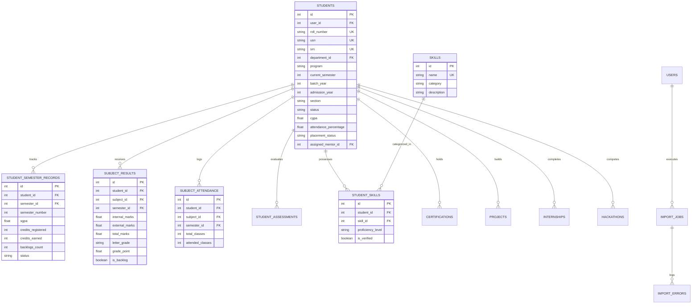

> **Archived — prototype v0.1 (historical).** This document describes the retired single-institution prototype and is not current ACEDRA documentation. Current documentation is one folder up, in `documentation/`.

# Module 1 — Student Intelligence & Analytics

## 1. Executive Summary

Module 1 establishes the **Student Intelligence & Analytics Engine**, unifying academic records, calculated attendance, continuous internal assessments (CIA), technical skill matrices, certifications, projects, internships, and bulk ingestion into a centralized institutional intelligence platform.

---

## 2. Core Functional Capabilities

### 2.1 Student Management & Directory
- **Listing & Search**: Multi-field indexed search by student name, USN, SRN, and roll number.
- **Filtering**: Real-time filtering across Departments, Semesters (1–8), Sections (A, B, C), and Student Status (`Active`, `Inactive`, `Graduated`, `Suspended`).
- **Profile Details**: Comprehensive dossier capturing University Seat Number (USN), Student Registration Number (SRN), Degree Program, Admission Year, Cohort Batch, Section, Guardian Contact, Blood Group, and Residential Address.
- **Role Isolation**: Students are strictly isolated to viewing only their own personal dossier; Administrators have full CRUD authority; Faculty and Mentors have cohort-level access.

### 2.2 Academic Progression & SGPA Trends
- **Semester Progression**: Historical SGPA tracking across Semesters 1 through 8.
- **Subject-Wise Results**: Detailed course breakdowns capturing:
  - Continuous Internal Assessment (CIA) marks (out of 50).
  - Semester End Examination (SEE) marks (out of 50).
  - Total combined score (out of 100).
  - Letter Grade (`O`, `A+`, `A`, `B+`, `B`, `C`, `P`, `F`).
  - Grade Points (`10.0`, `9.0`, `8.0`, etc.).
  - Backlog history flags.
- **Visual Trends**: Recharts `LineChart` showing SGPA progression across terms.

### 2.3 Attendance Intelligence (Count-Derived)
- **Raw Count Persistence**: Stores `total_classes` and `attended_classes` directly in the database.
- **Calculated Metric**: Dynamically calculates `attendance_percentage` as `(attended_classes / total_classes) * 100.0`. Never trusts manually entered percentages.
- **Visual Thresholds**:
  - `≥ 85%`: High Attendance (Emerald).
  - `75% - 85%`: Satisfactory Attendance (Amber).
  - `< 75%`: Critical Academic Risk (Rose alert badge).

### 2.4 Continuous Internal Assessments (CIA)
- Tracks Internal Assessment 1 (IA1), Internal Assessment 2 (IA2), Quizzes, Assignments, and Practical Lab Tests.
- Dynamically computes CIA averages and flags early academic distress.

### 2.5 Skill Taxonomy & Portfolio Matrix (Module 4 Ready)
- Structured classification:
  - `programming`: Python, Java, TypeScript, C++, Go, SQL
  - `framework`: React, FastAPI, Spring Boot, Node.js, Next.js, Tailwind CSS
  - `database`: PostgreSQL, Redis, MongoDB
  - `cloud`: Docker, AWS, Kubernetes
  - `tool`: Git, Linux
  - `soft_skill`: Technical Communication, Agile Methodology
- Proficiency Levels: `Beginner`, `Intermediate`, `Advanced`, `Expert`.
- Verified status badges with faculty sign-off readiness.
- Portfolio items: Engineering projects with GitHub repositories, verified industry certifications, and corporate internships.

### 2.6 Data Import Center (CSV & Excel)
- **Multi-Format Ingestion**: Ingests `.csv`, `.xlsx`, and `.xls` files.
- **Pre-Commit Validation**:
  - Column schema detection and header normalization.
  - Duplicate identification within the batch and against existing database records (USN, Email).
  - Missing required value flags.
  - Logical constraint validation (e.g. attended classes cannot exceed total classes).
- **Import Preview**: Displays valid and invalid row counts with row-level error callouts prior to database commit.
- **Downloadable Templates**: 1-click downloads for `students`, `academic_records`, and `attendance` templates.
- **Audit & History**: Persistent logging of every import batch with success and failure tallies.

### 2.7 Faculty & Institutional Analytics
- **Faculty Analytics**: Assigned course benchmark comparisons, departmental student cohort summaries, and average evaluation metrics.
- **Institutional Analytics**:
  - Total student enrollment and active status ratios.
  - Departmental comparative bar charts (CGPA vs Attendance).
  - Institutional CGPA Tier Distribution (Tier 1 `≥9.0`, Tier 2 `8.0–8.9`, Tier 3 `7.0–7.9`, Tier 4 `6.0–6.9`, At Risk `<6.0`).
  - Institutional Attendance Risk Distribution.
  - Bulk data ingestion audit log.

---

## 3. Database Schema Architecture

---

## 4. API Endpoints Reference

| Endpoint | Method | Role Permissions | Description |
| :--- | :---: | :---: | :--- |
| `/api/v1/students/` | GET | All authenticated (Role-Scoped) | List and search student directory with filters |
| `/api/v1/students/` | POST | Administrator only | Enroll a new student record |
| `/api/v1/students/{id}` | GET | Student (Self), Faculty, Mentor, Admin | Retrieve complete student profile dossier |
| `/api/v1/students/{id}` | PATCH | Admin (all fields), Student (personal info) | Update student profile information |
| `/api/v1/students/{id}/analytics` | GET | Student (Self), Faculty, Mentor, Admin | Consolidated intelligence: SGPA, results, attendance, skills |
| `/api/v1/students/{id}/skills` | POST | Student (Self), Admin | Add or update technical skill proficiency |
| `/api/v1/students/{id}/certifications` | POST | Student (Self), Admin | Record external industry certification |
| `/api/v1/students/{id}/projects` | POST | Student (Self), Admin | Link engineering / research project |
| `/api/v1/students/{id}/internships` | POST | Student (Self), Admin | Record corporate internship experience |
| `/api/v1/students/analytics/faculty` | GET | Faculty, Administrator | Cohort performance for assigned teaching courses |
| `/api/v1/students/analytics/admin` | GET | Administrator only | Institutional academic & attendance distributions |
| `/api/v1/imports/preview` | POST | Administrator only | Upload CSV/Excel to inspect duplicates & errors |
| `/api/v1/imports/execute` | POST | Administrator only | Commit validated batch import into database |
| `/api/v1/imports/template/{type}` | GET | Administrator only | Download standardized CSV template |
| `/api/v1/imports/jobs` | GET | Administrator only | Retrieve historical import batch log |

---

## 5. Visual Interface & Screenshot Gallery

Screenshots captured from the running application:

| Screen | Description | File Path |
| :--- | :--- | :--- |
| **Login Screen** | Responsive login portal with 1-click Demo credentials across all 5 roles | `documentation/screenshots/01_login_screen.png` |
| **Student Directory** | Student directory with multi-field search, filters, and status badges | `documentation/screenshots/02_student_directory.png` |
| **Profile Overview** | Student dossier overview with CGPA, calculated attendance, and contact info | `documentation/screenshots/03_student_profile_overview.png` |
| **Academic Progression** | Recharts SGPA progression curve across semesters and subject mark results | `documentation/screenshots/04_student_academic_progression.png` |
| **Attendance Intelligence** | Raw-count derived subject attendance with progress indicators | `documentation/screenshots/05_student_attendance_intelligence.png` |
| **Continuous Evaluations** | Internal assessment, quiz scores, and evaluation history | `documentation/screenshots/06_student_assessments.png` |
| **Skill Matrix** | Structured categorization of programming, frameworks, and cloud skills | `documentation/screenshots/07_student_skill_matrix.png` |
| **Projects & Experience** | Engineering projects, verified certifications, and internship records | `documentation/screenshots/08_student_portfolio_experience.png` |
| **Data Import Center** | CSV/Excel file validation, duplicate detection, and preview table | `documentation/screenshots/09_data_import_center.png` |
| **Institutional Analytics** | Campus-wide department performance bar chart and CGPA distribution | `documentation/screenshots/10_admin_institutional_analytics.png` |
| **Faculty Analytics** | Cohort analytics with allocated course comparison bar chart | `documentation/screenshots/11_faculty_cohort_analytics.png` |

---

## 6. Synthetic Demo Dataset Notice
- 30 synthetic student records (`1RV22SYN001` through `1RV22SYN030`) have been generated.
- These records span multiple departments (CSE, AI_DS, ECE, MECH) and semesters (3, 5, 7) with realistic variations in CGPA, attendance, backlogs, skills, certifications, and projects.
- **Notice**: All synthetic demo records are strictly generated for software prototype evaluation and do not represent actual student records.
