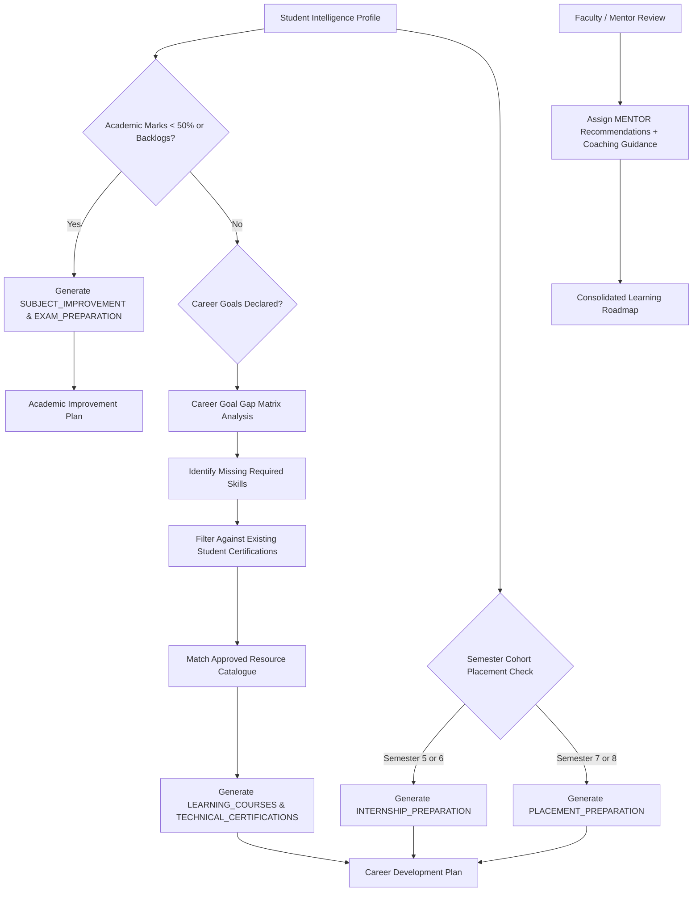
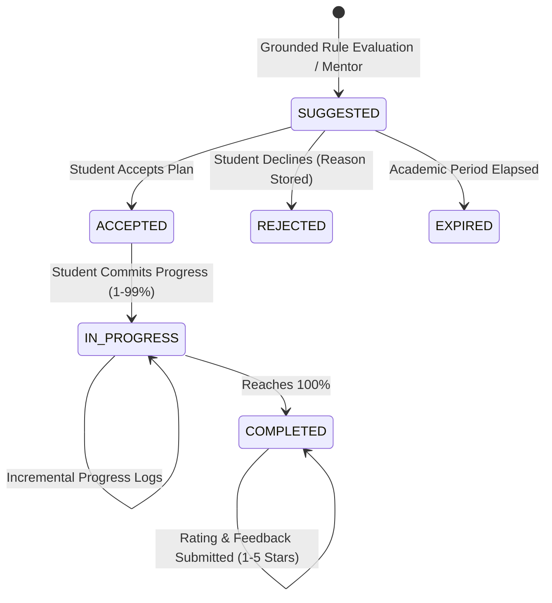
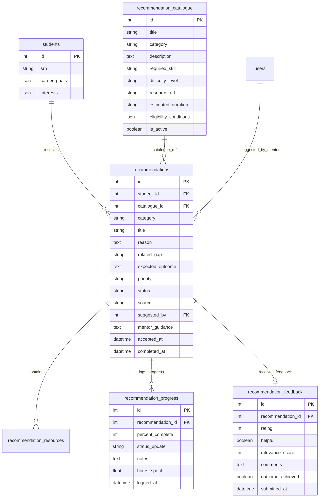

> **Archived — prototype v0.1 (historical).** This document describes the retired single-institution prototype and is not current ACEDRA documentation. Current documentation is one folder up, in `documentation/`.

# MODULE 3 — PERSONALISED RECOMMENDATION ENGINE

## 1. Executive & Technical Overview

Module 3 introduces a **personalized, rule-grounded academic and career development recommendation engine** into **Smart Campus Intelligence (RIO Prototype v0.1)**. Building directly upon student profiles, academic progression records, calculated attendance, skills, and portfolio data from Modules 0, 1, and 2, Module 3 generates targeted, actionable learning paths for every student.

> [!IMPORTANT]
> **Core Architectural Principles**:
> 1. **Data-Grounded Rationale (No Arbitrary Suggestions)**: Every recommendation originates strictly from verified student metrics—weak academic subjects (< 50% or backlogs), gaps between student skills and declared career goals, semester placement windows, or direct mentor coaching.
> 2. **Approved Resource Catalogue**: Learning courses, certifications, and practice tracks must map to administrator-curated, verified catalog items with validated URLs, difficulty tiers, and prerequisites.
> 3. **Separation of Plans**: Learning paths cleanly segregate into an **Academic Improvement Plan** (remedials, exam prep, continuous evaluation support) and a **Career Development Plan** (skill acquisition, technical certifications, internship & placement readiness).
> 4. **Progress & Feedback Loop**: Students track percent completion (0–100%) with incremental progress logs, and submit structured 5-star ratings, helpfulness votes, and qualitative reviews upon completion.
> 5. **Mentor Collaboration & Coaching**: Faculty and mentors can propose custom or catalog-backed recommendations (`source='MENTOR'`) and attach direct personalized coaching notes.

---

## 2. Recommendation Categories

Module 3 supports all 11 required recommendation categories across academic remediation and professional development:

| # | Category Identifier | Plan Allocation | Description | Typical Trigger Condition |
| :-: | :--- | :--- | :--- | :--- |
| 1 | `SUBJECT_IMPROVEMENT` | Academic | Targeted remedial tutorial sessions & office hours | Course marks < 50% or active backlog in subject |
| 2 | `STUDY_RESOURCES` | Academic | Lecture slides, textbook chapters, and recorded lectures | CIA continuous assessment deficit (< 40%) |
| 3 | `LEARNING_COURSES` | Career | Structured online modules & coursework | Missing technical skills required for career goal |
| 4 | `PROGRAMMING_PRACTICE` | Career | Coding challenges, algorithms, and data structures | Students targeting software engineering roles |
| 5 | `TECHNICAL_CERTIFICATIONS` | Career | Industry-standard credentials (AWS, GCP, CKA, CompTIA) | Missing certifications aligned with career aspirations |
| 6 | `SOFT_SKILL_DEVELOPMENT` | Career | Technical communication, writing, and leadership | Semesters 4–8 professional readiness |
| 7 | `EXAMINATION_PREPARATION` | Academic | Mock exam papers, question banks, and review sessions | High/Critical early-warning risk or backlog history |
| 8 | `PROJECT_SUGGESTIONS` | Career | Capstone and portfolio projects implementing missing skills | Low portfolio project count in major track |
| 9 | `INTERNSHIP_PREPARATION` | Career | Resume review, technical portfolio, and mock interviews | Students in Semesters 5–6 preparing for summer drives |
| 10 | `PLACEMENT_PREPARATION` | Career | Aptitude tests, DSA sprints, and mock HR rounds | Final-year students (Semesters 7–8) before recruitment |
| 11 | `HACKATHON_PARTICIPATION` | Career | Competitive hackathons and open-source sprints | Students with high programming aptitude seeking challenge |

---

## 3. Recommendation Logic & Grounded Gap Analysis

The recommendation engine adheres strictly to deterministic, transparent rules:



### Career Goal Gap Matrix

The platform models industry-verified competency frameworks for major career trajectories:

- **Full Stack Developer**: `Python`, `JavaScript`, `TypeScript`, `React`, `Node.js`, `SQL`, `Docker`
- **AI/ML Engineer**: `Python`, `Machine Learning`, `Deep Learning`, `PyTorch`, `TensorFlow`, `Computer Vision`, `NLP`
- **Cloud Architect**: `Linux`, `Cloud Computing`, `AWS`, `Terraform`, `Kubernetes`, `System Design`
- **Data Engineer**: `Python`, `SQL`, `Apache Spark`, `Kafka`, `Data Warehousing`, `ETL Pipelines`
- **Cybersecurity Analyst**: `Network Security`, `Linux`, `Cryptography`, `Ethical Hacking`, `SIEM`, `SOC Analysis`

When a student selects a career goal (e.g. *AI/ML Engineer*), the engine diffs the student's verified skills against the required competencies, identifies missing skills (e.g. *PyTorch*, *Deep Learning*), and matches only approved catalog resources tailored to those gaps.

---

## 4. Approved Resource Catalogue

Administrators curate and manage the official learning resource repository. 11 verified canonical items are pre-seeded:

| ID | Title | Category | Required Skill | Level | Estimated Duration | Verified Resource Link |
| :-: | :--- | :--- | :--- | :--- | :--- | :--- |
| 1 | Remedial Data Structures & Algorithms | `SUBJECT_IMPROVEMENT` | Data Structures | Beginner | 4 weeks | https://ocw.mit.edu/courses/electrical-engineering-and-computer-science/ |
| 2 | Full Stack Web Development Boot Camp | `LEARNING_COURSES` | React | Intermediate | 8 weeks | https://fullstackopen.com/en/ |
| 3 | Deep Learning with PyTorch Specialization | `LEARNING_COURSES` | PyTorch | Advanced | 6 weeks | https://www.deeplearning.ai/courses/ |
| 4 | AWS Certified Solutions Architect Associate | `TECHNICAL_CERTIFICATIONS` | AWS | Intermediate | 5 weeks | https://aws.amazon.com/certification/certified-solutions-architect-associate/ |
| 5 | Campus Placement Technical Aptitude Sprint | `PLACEMENT_PREPARATION` | Problem Solving | Advanced | 3 weeks | https://www.geeksforgeeks.org/campus-placement/ |
| 6 | Industry Summer Internship Readiness Track | `INTERNSHIP_PREPARATION` | Resume Building | Intermediate | 2 weeks | https://internshala.com/internships/ |
| 7 | End-to-End Microservices Capstone Project | `PROJECT_SUGGESTIONS` | Docker | Intermediate | 4 weeks | https://github.com/topics/microservices-architecture |
| 8 | LeetCode Top 100 Interview Algorithms Sprint | `PROGRAMMING_PRACTICE` | Algorithms | Intermediate | 4 weeks | https://leetcode.com/problem-list/top-interview-questions/ |
| 9 | Technical Communication & Executive Pitching | `SOFT_SKILL_DEVELOPMENT` | Communication | Beginner | 2 weeks | https://www.coursera.org/learn/technical-writing |
| 10 | Operating Systems & Core Theory Exam Prep | `EXAMINATION_PREPARATION` | Operating Systems | Intermediate | 2 weeks | https://pages.cs.wisc.edu/~remzi/OSTEP/ |
| 11 | National Smart Campus Open Hackathon Track | `HACKATHON_PARTICIPATION` | Full Stack | Advanced | 1 week | https://mlh.io/seasons/2026/events |

---

## 5. Lifecycle & Tracking Workflow

Each recommendation transitions through an audited state machine:



- **Progress Tracking**: Students log percentage complete, hours spent, and milestone notes.
- **Feedback & Quality Loop**: Completed items prompt 1–5 star ratings, helpfulness votes (`helpful=true/false`), relevance scoring, and qualitative comments, providing feedback to faculty and catalogue administrators.

---

## 6. Database Schema & Architecture

Module 3 adds 5 relational tables and extends the `students` profile:



---

## 7. REST API Endpoints

All endpoints are registered under `/api/v1/recommendations`:

| HTTP Method | Route | Access Control | Description |
| :--- | :--- | :--- | :--- |
| `GET` | `/catalogue` | Authenticated | Browse approved recommendation catalogue items with category/skill filters |
| `POST` | `/catalogue` | Admin / HOD | Add new approved resource to catalogue |
| `PUT` | `/catalogue/{id}` | Admin / HOD | Update existing catalogue resource |
| `DELETE` | `/catalogue/{id}` | Admin / HOD | Soft/hard delete catalogue resource |
| `POST` | `/generate/{student_id}` | Admin / Faculty / Mentor / Student (self) | Run grounded recommendation evaluation against student record |
| `GET` | `/` | Authenticated (scoped) | List recommendations with category, status, priority filters |
| `GET` | `/students/{student_id}/learning-path` | Authenticated (scoped) | Retrieve segmented Academic & Career learning plans |
| `PUT` | `/students/{student_id}/career-profile` | Student (self) / Mentor / Admin | Update student career goals and technical interest tags |
| `POST` | `/{id}/accept` | Student (self) | Accept a suggested recommendation |
| `POST` | `/{id}/reject` | Student (self) | Decline recommendation with documented reason |
| `POST` | `/{id}/progress` | Student (self) / Mentor | Log milestone progress percentage and hours spent |
| `POST` | `/{id}/feedback` | Student (self) | Submit 1–5 star rating and review on completed item |
| `POST` | `/suggest` | Faculty / Mentor / Admin | Propose custom or catalogue recommendation to student |
| `POST` | `/{id}/guidance` | Faculty / Mentor | Attach personalized mentor coaching guidance notes |

---

## 8. Verification & Test Suite

The test suite in `backend/tests/test_recommendation_engine.py` executes 7 rigorous automated test scenarios:

1. **`test_weak_subject_performance_recommendation`**: Verifies that marks < 50% trigger `SUBJECT_IMPROVEMENT` and `EXAMINATION_PREPARATION` recommendations.
2. **`test_missing_technical_skills_recommendation`**: Verifies that setting career goal *AI/ML Engineer* without PyTorch triggers `LEARNING_COURSES` and `TECHNICAL_CERTIFICATIONS`.
3. **`test_career_goal_learning_path`**: Verifies that `get_student_learning_path` cleanly splits items into Academic and Career plans.
4. **`test_healthy_profile_recommendations`**: Verifies that students in good academic standing receive advanced tracks and hackathon suggestions rather than remedial courses.
5. **`test_recommendation_lifecycle_and_feedback`**: Verifies status transitions `SUGGESTED` $\to$ `ACCEPTED` $\to$ `IN_PROGRESS` $\to$ `COMPLETED` and feedback submission.
6. **`test_mentor_suggest_and_guidance`**: Verifies faculty/mentor custom recommendations with source `MENTOR` and personalized coaching notes.
7. **`test_unauthorized_access_protection`**: Verifies that students cannot access other students' recommendation endpoints (HTTP 403 Forbidden).

**Test Suite Results**:
```bash
backend/.venv/bin/pytest backend/tests/
======================= 27 passed, 31 warnings in 5.15s ========================
```
- Module 0 (Auth & Base): 6 passed
- Module 1 (Student Analytics): 7 passed
- Module 2 (Risk Identification): 7 passed
- Module 3 (Recommendation Engine): 7 passed
- **Total: 27 / 27 passing tests (100% green)**

---

## 9. Screenshot Gallery

| Screen | Description | File |
| :--- | :--- | :--- |
| **Personalized Recommendations Dashboard** | Academic Improvement & Career Development plans, KPI counters, career goals header, and filter controls | `16_recommendations_dashboard.png` |
| **Recommendation Detail & Tracking Modal** | Grounded why-recommended explanation, target gap, duration, progress tracker, and 5-star feedback form | `17_recommendation_detail_modal.png` |
| **Career Profile & Goals Modal** | Career path selection (AI/ML Engineer, Full Stack, Cloud), interest tags, and automated roadmap refresh | `18_career_goals_interests_modal.png` |
| **Resource Catalogue Browser Modal** | Administrator-managed verified catalogue items with category pills, difficulty filters, and verified links | `19_catalogue_browser_modal.png` |
