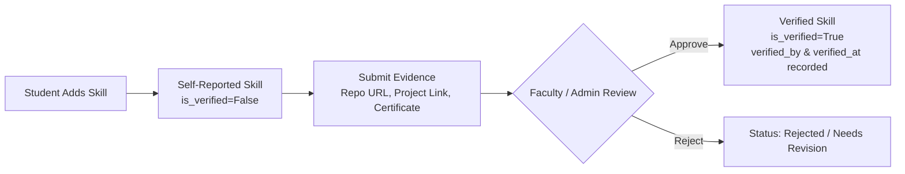
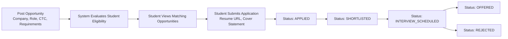

> **Archived — prototype v0.1 (historical).** This document describes the retired single-institution prototype and is not current ACEDRA documentation. Current documentation is one folder up, in `documentation/`.

# MODULE 4 — SKILL GAP & PLACEMENT READINESS

## 1. Executive & Technical Overview

Module 4 delivers a **Career Readiness, Skill Gap Analysis, and Campus Placement Operations Engine** for **Smart Campus Intelligence (RIO Prototype v0.1)**. Building directly on the foundational infrastructure of Modules 0, 1, 2, and 3, this module compares student competency profiles against configurable industry role benchmarks, quantifies skill readiness without misleading guarantees, identifies targeted learning actions, and equips placement officers with recruitment drive management and applicant tracking pipelines.

> [!IMPORTANT]
> **Core Architectural Principles**:
> 1. **Data-Grounded Readiness Assessment**: Readiness is calculated from verified student skills, continuous assessment metrics, and portfolio evidence rather than subjective self-evaluations.
> 2. **Explicit Verification Tiers**: Self-reported skills are clearly distinguished from verified skills. Students must submit verifiable evidence (GitHub repositories, live deployments, certification credentials) which faculty or administrators confirm.
> 3. **Non-Guarantee Advisory Disclaimer**: In accordance with academic ethics and platform specifications, readiness scores are explicitly labeled as internal prototype indicators for guidance, not employer-certified placement guarantees.
> 4. **Weighted Proficiency Gap Engine**: Roles specify skills with importance weights (`CRITICAL` = 3.0, `CORE` = 2.0, `PREFERRED` = 1.0) and required proficiencies (`Beginner` = 1, `Intermediate` = 2, `Advanced` = 3, `Expert` = 4). Partial credit is computed transparently.
> 5. **Institutional Placement Lifecycle**: Placement officers post recruitment drives with multi-factor eligibility criteria (minimum CGPA, max backlogs, minimum attendance, allowed departments, and eligible semesters). Students view eligibility breakdowns and track applications through `APPLIED`, `SHORTLISTED`, `INTERVIEW_SCHEDULED`, `OFFERED`, or `REJECTED`.

---

## 2. Skill Catalogue Taxonomy

The system provides a standardized, hierarchical skill catalogue spanning both technical proficiencies and essential professional competencies:

| Category Code | Category Name | Sample Canonical Skills |
| :--- | :--- | :--- |
| `PROGRAMMING_LANGUAGE` | Programming Languages | Python, TypeScript, JavaScript, Java, C++, Go, Rust |
| `FRAMEWORK` | Frameworks & Libraries | React, FastAPI, Node.js, Spring Boot, Next.js, Django, Express.js |
| `DATABASE` | Databases & Storage | PostgreSQL, MongoDB, Redis, MySQL, DynamoDB |
| `CLOUD_DEVOPS` | Cloud & DevOps | AWS, Docker, Kubernetes, CI/CD Pipelines, Terraform, Azure |
| `DATA_SCIENCE` | Data Science & Analytics | Pandas, NumPy, SQL for Analytics, Tableau, Power BI, Statistics |
| `ARTIFICIAL_INTELLIGENCE` | AI & Machine Learning | PyTorch, TensorFlow, Scikit-Learn, LangChain, NLP, Computer Vision |
| `CYBERSECURITY` | Cybersecurity & Infosec | Network Security, Ethical Hacking, OWASP Top 10, Cryptography |
| `SOFT_SKILL` | Professional & Soft Skills | Technical Communication, Agile Collaboration, Problem Solving, Leadership |

### Proficiency Scale & Numerical Mapping

Proficiencies are standardized across 4 tiers:
- **Beginner (Level 1)**: Basic conceptual understanding and syntax; requires guidance.
- **Intermediate (Level 2)**: Capable of independent implementation of standard features.
- **Advanced (Level 3)**: Deep architectural understanding; builds production-grade, optimized systems.
- **Expert (Level 4)**: Mastery of internals, performance profiling, and systems design.

---

## 3. Student Skill Profiles & Evidence Verification

Students build and maintain their technical and professional dossiers. To ensure institutional integrity, skills carry an explicit verification lifecycle:



### Evidence Types
- `PROJECT_URL`: Live deployed web application or API service (e.g., Vercel, Render).
- `GITHUB_REPO`: Public code repository with commit history and test suites.
- `CERTIFICATION`: Industry credential with verification ID and issuance authority.
- `ASSESSMENT_RESULT`: Institutional coding contest or laboratory evaluation record.
- `DOCUMENT`: Research paper or whitepaper.

---

## 4. Career Role Catalogue & Competency Benchmarking

Placement officers and administrators configure target industry roles with explicit competency benchmarks and importance weights:

### Canonical Roles Seeded

| Role Title | Role Code | Focus Domain | Key Benchmark Skills |
| :--- | :--- | :--- | :--- |
| **Software Developer** | `SOFTWARE_DEVELOPER` | Backend & Systems | Python (Adv), TypeScript (Int), SQL (Adv), Docker (Int), Problem Solving (Adv) |
| **Full Stack Developer** | `FULL_STACK_DEVELOPER` | Web Applications | React (Adv), Node.js (Adv), TypeScript (Int), PostgreSQL (Int), Docker (Int) |
| **Data Analyst** | `DATA_ANALYST` | Business Intelligence | SQL (Adv), Python (Int), Tableau (Adv), Statistics (Int), Communication (Int) |
| **Data Scientist** | `DATA_SCIENTIST` | Predictive Modeling | Python (Adv), Machine Learning (Adv), Statistics (Adv), SQL (Int) |
| **AI/ML Engineer** | `AI_ML_ENGINEER` | Deep Learning & Systems | PyTorch (Adv), Python (Adv), Docker (Int), Cloud/AWS (Int), NLP (Int) |
| **Cloud Engineer** | `CLOUD_ENGINEER` | Infrastructure & DevOps | AWS (Adv), Docker (Adv), Kubernetes (Int), CI/CD (Adv), Linux (Adv) |
| **Cybersecurity Analyst** | `CYBERSECURITY_ANALYST` | Security & Forensics | Network Security (Adv), Ethical Hacking (Int), OWASP (Adv), Linux (Adv) |

### Role Skill Configuration Attributes
- `required_proficiency`: Benchmark proficiency required for entry-level hiring.
- `importance`: `CRITICAL` (Weight 3.0), `CORE` (Weight 2.0), `PREFERRED` (Weight 1.0).
- `is_mandatory`: Boolean flag indicating non-negotiable prerequisite skills.

---

## 5. Transparent Skill Gap Engine & Mathematical Scoring

The readiness score is deterministically calculated using weighted competency coverage:

### Mathematical Scoring Formula

For a student $S$ evaluated against career role $R$ having $N$ required skills $\{s_1, s_2, \dots, s_N\}$:

$$\text{Weight}(s_i) = \begin{cases} 3.0 & \text{if } s_i.\text{importance} = \text{CRITICAL} \\ 2.0 & \text{if } s_i.\text{importance} = \text{CORE} \\ 1.0 & \text{if } s_i.\text{importance} = \text{PREFERRED} \end{cases}$$

$$\text{Target Level}(s_i) = \text{ProficiencyLevel}(s_i.\text{required\_proficiency}) \in \{1, 2, 3, 4\}$$

$$\text{Student Level}(s_i) = \begin{cases} 0 & \text{if unacquired} \\ \text{ProficiencyLevel}(s_i.\text{student\_proficiency}) & \text{if acquired} \end{cases}$$

$$\text{Skill Score}(s_i) = \min\left(1.0, \frac{\text{Student Level}(s_i)}{\text{Target Level}(s_i)}\right) \times \text{Weight}(s_i)$$

$$\text{Raw Readiness Score} = \frac{\sum_{i=1}^N \text{Skill Score}(s_i)}{\sum_{i=1}^N \text{Weight}(s_i)} \times 100\%$$

### Readiness Tiers

| Readiness Tier | Score Range | Mandatory Skills Requirement | Prototype Readiness Status |
| :--- | :---: | :---: | :--- |
| `READY` | $\ge 85\%$ | All mandatory skills met | Placement-ready for campus recruitment drives |
| `NEAR_READY` | $70\% - 84\%$ | May have minor non-critical deficits | Target 2–4 week intensive upskilling |
| `DEVELOPING` | $50\% - 69\%$ | Core competencies under development | Active coursework & remedial practice recommended |
| `EARLY_STAGE` | $< 50\%$ | Substantial foundational skill gaps | Comprehensive foundational curriculum required |

### Gap Classification Categories
- **`MATCHED`**: Student level $\ge$ required level, verified with supporting evidence.
- **`REQUIRES_VERIFICATION`**: Student meets or exceeds proficiency, but skill is self-reported and lacks verified evidence.
- **`BELOW_PROFICIENCY`**: Student possesses the skill but proficiency is lower than role benchmark (receives proportional partial credit).
- **`MISSING`**: Student has not acquired the required skill (0 credit).

### Mandatory Prototype Disclaimer
Every readiness evaluation payload and frontend view prominently displays:
> *"Advisory Prototype Indicator: Placement readiness scores and skill gap analyses are advisory indicators generated to guide personal learning and development. They do not constitute employer-certified placement evaluations, hiring commitments, or institutional eligibility guarantees."*

---

## 6. Placement Officer Recruitment Console

Placement officers manage active campus recruitment drives and monitor the candidate pipeline:



### Multi-Criteria Eligibility Verification Algorithm
When evaluating whether student $S$ is eligible for opportunity $O$:
1. **Academic Standing**: $S.\text{CGPA} \ge O.\text{min\_cgpa}$
2. **Backlogs**: $S.\text{active\_backlogs} \le O.\text{max\_backlogs\_allowed}$
3. **Attendance Discipline**: $S.\text{attendance\_percentage} \ge O.\text{min\_attendance\_pct}$
4. **Department Eligibility**: $S.\text{department\_code} \in O.\text{eligible\_departments}$ (or unrestricted)
5. **Cohort Semester**: $S.\text{semester} \in O.\text{eligible\_semesters}$ (or unrestricted)

The API returns a boolean `is_eligible` along with detailed `eligibility_criteria_met` breakdown flags for full transparency.

---

## 7. REST API Endpoints Specification

All Module 4 endpoints are nested under `/api/v1/placement`:

| HTTP Method | Route | Access | Description |
| :--- | :--- | :--- | :--- |
| `GET` | `/api/v1/placement/skills` | Authenticated | List all skills in standard taxonomy |
| `POST` | `/api/v1/placement/skills` | Admin / Placement | Add new skill to standard catalogue |
| `GET` | `/api/v1/placement/student-skills/{student_id}` | Authenticated | Retrieve student's declared & verified skills |
| `POST` | `/api/v1/placement/student-skills/{student_id}` | Student / Admin | Add or update a student skill |
| `POST` | `/api/v1/placement/evidence` | Student / Admin | Submit portfolio URL, repo, or certificate evidence |
| `PUT` | `/api/v1/placement/evidence/{evidence_id}/verify` | Faculty / Admin / Placement | Approve or reject submitted skill evidence |
| `GET` | `/api/v1/placement/roles` | Authenticated | List active career roles and benchmark requirements |
| `POST` | `/api/v1/placement/roles` | Placement / Admin | Create or configure career role and skill weights |
| `GET` | `/api/v1/placement/roles/{role_id}` | Authenticated | Get detailed role requirements and competency weights |
| `GET` | `/api/v1/placement/readiness/{student_id}` | Authenticated | Compute real-time readiness score and gap analysis |
| `GET` | `/api/v1/placement/opportunities` | Authenticated | List active recruitment drives and opportunities |
| `POST` | `/api/v1/placement/opportunities` | Placement / Admin | Post new recruitment drive / internship |
| `GET` | `/api/v1/placement/students/{student_id}/matching-opportunities` | Authenticated | Retrieve matching drives with eligibility breakdown |
| `POST` | `/api/v1/placement/applications` | Student / Placement | Submit campus placement drive application |
| `GET` | `/api/v1/placement/applications` | Authenticated | List applications (filterable by student, drive, status) |
| `PUT` | `/api/v1/placement/applications/{application_id}/status` | Placement / Admin | Transition candidate stage in recruitment pipeline |

---

## 8. Automated Verification & Test Results

The platform automated verification suite was executed against SQLite (`smart_campus.db`):

```bash
./backend/.venv/bin/pytest backend/tests/
```

### Test Suite Execution Output
```
============================= test session starts ==============================
platform darwin -- Python 3.14.8, pytest-9.2.0, pluggy-1.7.0
rootdir: /Users/sanith/Documents/RIO/RIO Prototype v0.1/backend
configfile: pytest.ini
plugins: anyio-4.16.0
collected 34 items

backend/tests/test_auth.py ......                                        [ 17%]
backend/tests/test_placement_readiness.py .......                        [ 38%]
backend/tests/test_recommendation_engine.py .......                      [ 58%]
backend/tests/test_risk_intelligence.py .......                          [ 79%]
backend/tests/test_student_intelligence.py .......                       [100%]

======================= 34 passed, 38 warnings in 6.57s ========================
```

### Module 4 Test Scenarios Breakdown

| # | Test Case Identifier | Scenario Verified | Status |
| :-: | :--- | :--- | :-: |
| 1 | `test_complete_skill_match_readiness` | Student with all required skills at target proficiencies achieves $\ge 85\%$ score and `READY` tier. | **PASS** |
| 2 | `test_missing_skills_gap_detection` | Student missing mandatory skills is flagged with `MISSING` status and mandatory deficit. | **PASS** |
| 3 | `test_low_proficiency_partial_credit` | Student below required proficiency receives proportional partial credit and `BELOW_PROFICIENCY` status. | **PASS** |
| 4 | `test_readiness_across_different_career_roles` | Student evaluated against different roles (Software Developer vs Cloud Engineer) produces distinct role-specific gap profiles. | **PASS** |
| 5 | `test_student_skill_updates_and_evidence_verification` | Student self-reports skill, attaches GitHub URL evidence; faculty verifies evidence; skill transitions to `is_verified=True`. | **PASS** |
| 6 | `test_opportunity_matching_and_application_lifecycle` | Multi-factor eligibility check accurately evaluates CGPA, backlogs, and attendance; student applies; placement officer updates status. | **PASS** |
| 7 | `test_unauthorized_placement_operations` | Student attempting to create recruitment drives or verify evidence is denied with HTTP 403 Forbidden. | **PASS** |

---

## 9. Visual Interface Gallery

The user interface for Module 4 has been captured in high-resolution screenshots:

### 1. Student Placement Readiness Hub

*Role benchmark selector, readiness score gauge (88% READY), non-guarantee prototype disclaimer, 4 KPI stat cards, and competency gap breakdown.*

### 2. Skill Gap Analysis & Proficiency Benchmark Chart

*Recharts comparative bar visualization juxtaposing student proficiency level against role benchmark level across all competencies.*

### 3. Placement Officer Recruitment Console

*Recruitment drive manager, applicant pipeline tracking (Applied, Shortlisted, Interview Scheduled, Offered), and career role competency weights.*

### 4. Matching Corporate Opportunities & Student Application Portal

*Eligible recruitment drives with multi-factor criteria verification badges and 1-click application submission modal.*
