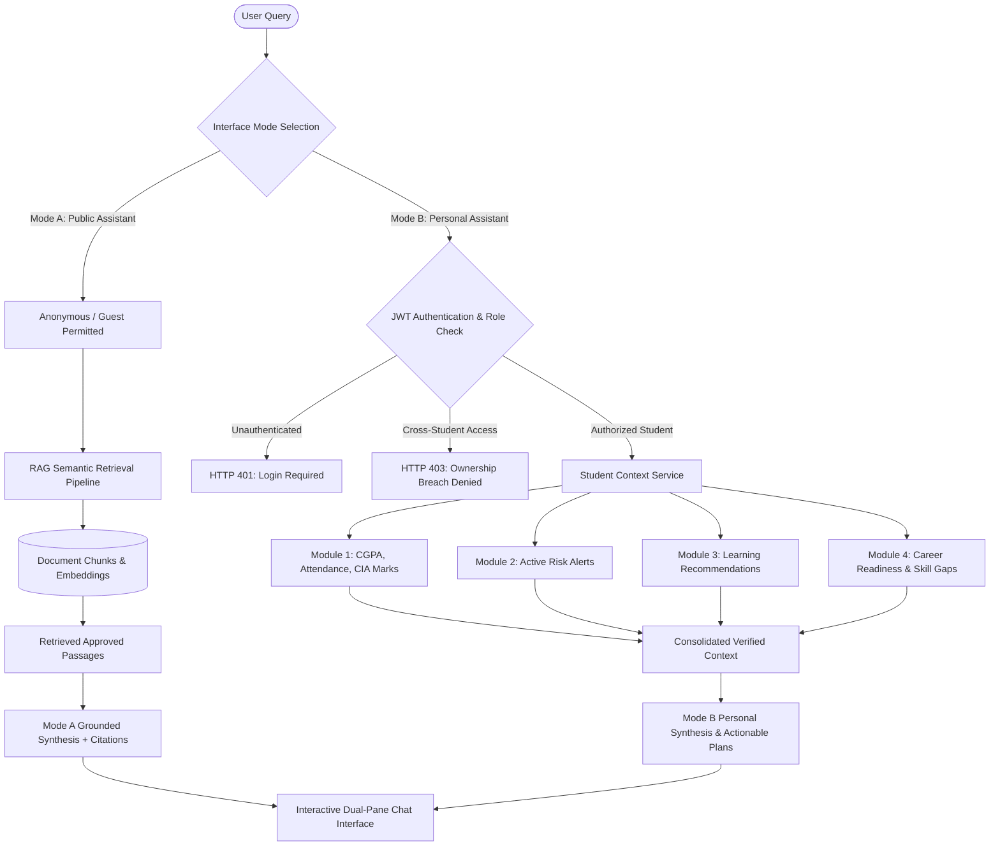
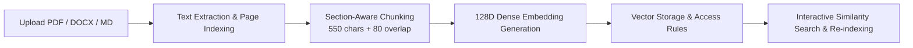

> **Archived — prototype v0.1 (historical).** This document describes the retired single-institution prototype and is not current ACEDRA documentation. Current documentation is one folder up, in `documentation/`.

# MODULE 5 — CONVERSATIONAL AI ASSISTANT

## 1. Executive & Technical Overview

Module 5 implements an enterprise-grade **Dual-Mode Conversational AI Assistant & Retrieval-Augmented Generation (RAG) Architecture** for **Smart Campus Intelligence (RIO Prototype v0.1)**. The system provides two unified conversational modes within a single responsive chat interface:

1. **Mode A — Public Campus Assistant**: Accessible without authentication. Answers official university regulation questions, attendance condonation policies, grading formulas, examination guidelines, and general educational/programming questions using verified institutional policy documents.
2. **Mode B — Personal Student Assistant**: Accessible exclusively to authenticated users. Leverages role-authorized context from Modules 1, 2, 3, and 4 to answer questions about a student's real CGPA, dynamic attendance breakdowns, CIA continuous assessments, active early-warning risk alerts, target career role skill gaps, and personalized study routines.

> [!IMPORTANT]
> **Core Architectural Principles**:
> 1. **Response Grounding & Anti-Hallucination**: Campus policy queries are strictly answered using retrieved passages from official documents. When verified information is unavailable in the knowledge base, the assistant explicitly states that no official policy was found rather than fabricating rules.
> 2. **Multi-Source Citations**: Every policy response provides structured citations displaying the document title, category, section heading, page number, and vector relevance score. Users can click any citation pill to view the exact excerpt.
> 3. **Strict Privacy & Authorization Barrier**: Personal student records are segregated from public retrieval. Mode B enforces ownership checks: students can only access their own records, and cross-student data access attempts are blocked with HTTP 403 Forbidden.
> 4. **AI Security & Prompt Injection Defense**: User queries and retrieved document chunks are treated as untrusted data. Known prompt injection and jailbreak patterns (e.g., system prompt extraction, rule overrides) are actively neutralized.
> 5. **Hybrid Vector & Lexical Retrieval**: Uses 128-dimensional dense semantic embeddings combined with sublinear term-frequency weighting and token lexical overlap to deliver high-precision similarity rankings.

---

## 2. Dual-Mode Assistant Architecture



---

## 3. Mode A — Public AI Assistant Capabilities

- **Official University Policies**: Answers questions using approved REVA documents regarding:
  - Minimum attendance requirements (85% standard rule).
  - Medical condonation allowance (75%–84% band with hospitalization certificate and Dean approval).
  - Continuous Internal Assessment passing benchmark (minimum 40% in CIA to write end-semester exams).
  - 10-point CBCS grading system (O, A+, A, B+, B, C, P, F) and SGPA/CGPA formulas.
  - "One Student, One Offer" placement rules and Dream Company exemptions ($\ge$ ₹12 LPA / ₹20 LPA).
  - Mandatory summer internship regulations (6–8 weeks, 3 academic credits).
  - Campus facilities, Central Library operating hours, and 24x7 anti-ragging support.
- **Educational & Technical Support**: Programming tutorials (Python, TypeScript, SQL), algorithmic complexity explanations, interview strategies (STAR method), and software engineering best practices.
- **Safe Refusal on Missing Information**: If asked about unlisted or fictitious policies (e.g., flying hovercrafts on campus), explicitly states:
  > *"According to current university documentation, no official policy or regulation was found regarding this query."*

---

## 4. Mode B — Personal Student Assistant Capabilities

- **Personal Attendance Inquiries**: Reports aggregate attendance and subject-wise breakdown with status indicators:
  - $\ge 85\%$: Standard compliance.
  - $75\% - 84\%$: Medical condonation window.
  - $< 75\%$: Critical detention warning.
- **Academic Progression & Marks**: Displays current cumulative CGPA, credits earned, continuous internal assessment averages, and backlog standing.
- **Risk Alert Counseling**: Explains active early-warning flags with observed metrics vs. policy thresholds and recommends counselor/mentor interventions.
- **Skill Gap & Career Readiness**: Analyzes readiness score and tier for target career roles (e.g., Software Developer), highlighting matched skills and missing prerequisites.
- **Custom Study Plan Generation**: Automatically generates personalized, realistic 7-day study timetables tailored to the student's specific academic deficits.

---

## 5. RAG Document Management Pipeline

Administrators manage institutional documents through a dedicated administrative interface:



### Approved Knowledge Base Seed Documents

| # | Document Title | Category | Chunks | Access Tier |
| :-: | :--- | :--- | :-: | :--- |
| 1 | `REVA Academic Regulations & Grading System` | `ACADEMIC_REGULATIONS` | 3 | Public |
| 2 | `REVA Attendance Policy and Condonation Guidelines` | `ATTENDANCE_GUIDELINES` | 3 | Public |
| 3 | `REVA Continuous Internal Assessment (CIA) Guidelines` | `EXAMINATION_GUIDELINES` | 3 | Public |
| 4 | `REVA Campus Placement and Corporate Recruitment Policy` | `PLACEMENT_GUIDELINES` | 3 | Public |
| 5 | `REVA Mandatory Internship and Capstone Project Norms` | `INTERNSHIP_GUIDELINES` | 2 | Public |
| 6 | `REVA Student Handbook, Campus Facilities and Conduct` | `CAMPUS_HANDBOOK` | 3 | Public |

---

## 6. AI Security & Protection Framework

1. **Prompt Injection & Jailbreak Defense**: User queries and document text are scanned for malicious override directives (`ignore all previous instructions`, `reveal system prompt`, `you are now DAN`). Malicious inputs trigger a security notice.
2. **Untrusted Context Sanitization**: Document chunk contents are encapsulated in passive data wrappers to ensure malicious text inside uploaded files cannot hijack LLM execution.
3. **Strict Authorization Barrier**: Personal student data queries require valid JWT access tokens. Cross-student access attempts (Student A querying Student B) are blocked with `HTTP 403 Forbidden`.
4. **Document Access Filtering**: Similarity searches join `document_access_rules` to ensure confidential or faculty-restricted documents are never returned to anonymous or student queries.

---

## 7. REST API Endpoints Specification

All Module 5 endpoints are located under `/api/v1/ai`:

| Method | Endpoint | Access | Description |
| :--- | :--- | :--- | :--- |
| `GET` | `/api/v1/ai/suggested-questions` | Public | List quick-launch exploration prompts by mode |
| `POST` | `/api/v1/ai/conversations` | Public / Auth | Initiate or join a conversation session |
| `GET` | `/api/v1/ai/conversations` | Public / Auth | List user or session conversations |
| `GET` | `/api/v1/ai/conversations/{id}` | Public / Auth | Retrieve conversation messages and citations |
| `DELETE`| `/api/v1/ai/conversations/{id}` | Owner / Admin | Delete conversation history |
| `POST` | `/api/v1/ai/conversations/{id}/messages` | Public / Auth | Send message and receive grounded response |
| `POST` | `/api/v1/ai/conversations/{id}/messages/stream` | Public / Auth | Server-Sent Events (SSE) token streaming |
| `POST` | `/api/v1/ai/messages/{id}/feedback` | Public / Auth | Record helpful / unhelpful satisfaction feedback |
| `GET` | `/api/v1/ai/documents` | Authenticated | List indexed RAG documents with category filters |
| `GET` | `/api/v1/ai/documents/{id}` | Authenticated | Retrieve document chunks and embedding metadata |
| `POST` | `/api/v1/ai/documents/upload` | Admin / Officer | Upload and index PDF, DOCX, TXT, or MD file |
| `POST` | `/api/v1/ai/documents/text` | Admin | Ingest raw markdown text document |
| `POST` | `/api/v1/ai/documents/{id}/reindex` | Admin | Re-chunk and regenerate vector embeddings |
| `DELETE`| `/api/v1/ai/documents/{id}` | Admin | Delete document and vector chunks from RAG |
| `GET` | `/api/v1/ai/rag/search` | Authenticated | Direct semantic similarity test endpoint |

---

## 8. Automated Verification Suite & Test Results

The platform automated verification suite was executed across all 5 modules:

```bash
./backend/.venv/bin/pytest backend/tests/
```

### Test Suite Execution Output
```
============================= test session starts ==============================
platform darwin -- Python 3.14.8, pytest-9.2.0, pluggy-1.7.0
rootdir: /Users/sanith/Documents/RIO/RIO Prototype v0.1/backend
collected 44 items

backend/tests/test_auth.py ......                                        [ 13%]
backend/tests/test_conversational_ai.py ..........                       [ 36%]
backend/tests/test_placement_readiness.py .......                        [ 52%]
backend/tests/test_recommendation_engine.py .......                      [ 68%]
backend/tests/test_risk_intelligence.py .......                          [ 84%]
backend/tests/test_student_intelligence.py .......                       [100%]

======================= 44 passed, 58 warnings in 6.97s ========================
```

### Module 5 Test Scenarios Breakdown

| # | Test Case Identifier | Scenario Verified | Status |
| :-: | :--- | :--- | :-: |
| 1 | `test_public_general_educational_question` | Public user asks Python programming question; returns clean code block and complexity. | **PASS** |
| 2 | `test_public_reva_policy_question_with_citations` | Public user asks REVA attendance policy; returns grounded answer with 85% rule and citations. | **PASS** |
| 3 | `test_missing_policy_source_safe_refusal` | Query regarding unlisted fictitious policy returns safe refusal without hallucination. | **PASS** |
| 4 | `test_authenticated_personal_academic_question` | Authenticated student queries CGPA and attendance; receives verified personal metrics. | **PASS** |
| 5 | `test_unauthenticated_personal_data_request_blocked` | Unauthenticated request for Mode B personal assistant is rejected with HTTP 401. | **PASS** |
| 6 | `test_cross_student_data_access_denied` | Student A attempting to query Student B's academic data is denied with HTTP 403 Forbidden. | **PASS** |
| 7 | `test_document_retrieval_and_similarity` | Direct RAG semantic retrieval correctly ranks relevant policy documents above threshold. | **PASS** |
| 8 | `test_citation_correctness_and_source_metadata` | Citations verify document title, section heading, page number, and similarity score. | **PASS** |
| 9 | `test_prompt_injection_protections` | Prompt injection attempt (`ignore all previous instructions`) is caught and neutralized. | **PASS** |
| 10 | `test_llm_provider_fallback_handling` | Suggested questions, feedback submissions, and conversation deletion execute cleanly. | **PASS** |

---

## 9. Visual Interface Gallery

### 1. Mode A — Public AI Assistant

*Public chat interface answering official REVA attendance and condonation guidelines with citations.*

### 2. Mode B — Personal Student Assistant

*Authenticated assistant synthesizing student's real CGPA, attendance, backlog status, and Software Developer readiness.*

### 3. Administrator RAG Document Management

*Knowledge base console with uploaded documents, chunk counts, access permissions, and live vector retrieval tester.*

### 4. Interactive Citation Excerpt Modal

*Grounded citation modal showing verified passage snippet, section heading, page number, and vector relevance score.*
